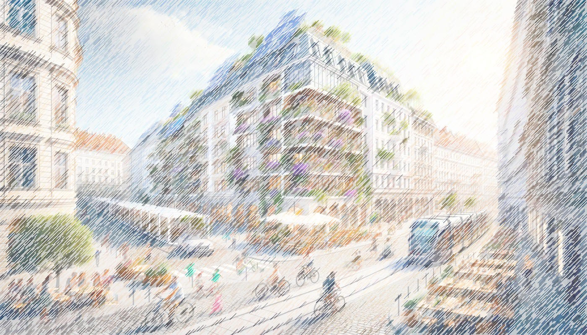

::: {.hero}
::: {}
::: {.eyebrow}
FH Technikum Wien · Forschung & Lehre
:::

# Gebäude verstehen. Quartiere weiterdenken. {.unnumbered}

::: {.lead}
Wir erforschen, wie Gebäude und Stadtquartiere klimafit werden: mit dynamischen Modellen, experimentellen Untersuchungen und einem Blick auf das Zusammenspiel von Technik, Umwelt und Menschen.
:::

[Forschungsprojekte entdecken](projects.qmd){.btn .btn-primary}
[Unser Teamprofil](about.qmd){.btn .btn-outline-primary}
:::
::: {}

:::
:::

## Unsere Forschungsfelder

::: {.topic-grid}
::: {}
### Klimafitte Sanierung
Bestandsgebäude und Quartiere schrittweise weiterentwickeln – mit Blick auf Komfort, Ressourcen und soziale Verträglichkeit.

[Zum Projekt FluccoSAN →](projects/fluccosan.qmd)
:::
::: {}
### Gebäude & Energiesystem
Wärme, Kälte und Speicher dynamisch modellieren. Flexibilität nutzbar machen und Gebäude mit den Anforderungen der Netze verbinden.

[Zum Projekt EnerFlexBuildings →](projects/enerflexbuildings.qmd)
:::
::: {}
### Klimaneutrale Quartiere
Energie, Mobilität und graue Energie gemeinsam betrachten. Maßnahmen bewerten und Menschen in die Quartiersentwicklung einbeziehen.

[Zum Alliiertenviertel →](projects/alliiertenviertel.qmd)
:::
:::

## Bewerten. Beteiligen. Modellieren. Prüfen.

**Climate-fit Buildings and Districts (CBD)** gehört zum Department Industrial Engineering der FH Technikum Wien. Gemeinsam mit Renewable Energy Technologies und Resilient Energy Systems bearbeiten wir Fragen erneuerbarer Energiesysteme – von der Bewertung über die Modellierung bis zur Umsetzung.

Unsere gemeinsame Methodenbasis umfasst Simulation, Monitoring, Datenanalyse, Lebenszyklusbetrachtung sowie Beteiligungsprozesse. Welche Methoden in einem Projekt eingesetzt werden, zeigen die jeweiligen Projektseiten.

::: {.section-note}
**Forschung greifbar machen**\
Entdecken Sie Projekte, Methoden und Anwendungsfelder für klimafitte Gebäude und Quartiere. Kurze Beispiele zeigen, welche Fragen unsere Forschung verbindet.

[Zu den Kurzbeispielen →](examples.qmd)
:::
