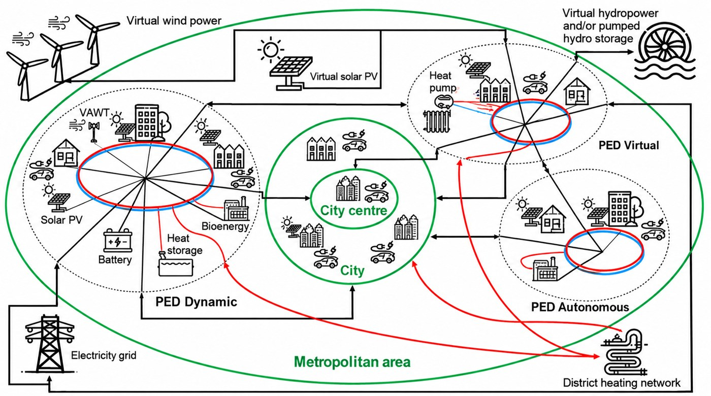

## Worum geht es?

Vier Living Labs verbinden technoökonomische Simulationen mit Beteiligung und gemeinsamer Gestaltung. Neben Effizienz und erneuerbaren Energien berücksichtigt das Projekt Suffizienz, Bezahlbarkeit und lokale Rahmenbedingungen.

::: {.project-figure}

:::

## Forschung und Anwendung

Zu den Ergebnissen gehören Szenariobibliotheken, vier PED-Aktionspläne und Leitlinien sowie ein Vorschlag für eine CEN-Workshop-Vereinbarung.

## Projektdaten

| Feld | Angabe |
|:--|:--|
| Laufzeit | November 2022 - Oktober 2025 |

[← Alle Forschungsprojekte](../projects.qmd)
