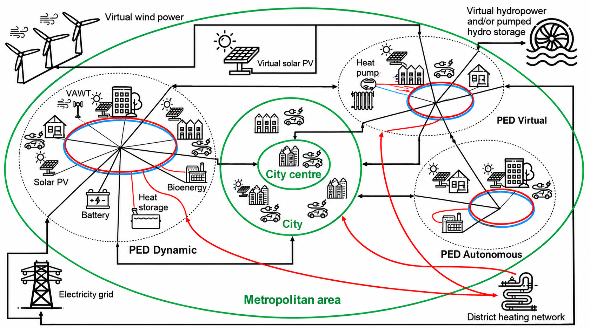

## Ausgangslage und Ziele

Citizens4PED untersucht, wie Plusenergiequartiere im bestehenden Stadtraum technisch machbar, bezahlbar und inklusiv entwickelt werden können. Lokale Gegebenheiten und politisch-rechtliche Rahmenbedingungen werden gemeinsam mit Bewohner:innen und Institutionen betrachtet.

## Vier Living Labs

Die Living Labs **La Roue, USquare, Kahlenbergerdorf und San Paolo** verbinden Modellierung mit Beteiligung. Simulationsszenarien werden hinsichtlich Machbarkeit, Bezahlbarkeit und Akzeptanz durch Bewohner:innen, Wohnungsbaugesellschaften und Kommunen bewertet.

Neben Effizienz und erneuerbaren Energien berücksichtigt das Projekt **Suffizienz**: menschliche Bedürfnisse mit möglichst geringem Ressourcenverbrauch zu erfüllen.

## Methodik

Eine Mitchell-Agle-Wood-Typologie der Interessengruppen, eine Akteur-Verbindungsmatrix und ein „Policy Canvas“ machen Zuständigkeiten, Vorschriften und Anreize innerhalb von Energiegemeinschaften sichtbar. Ein kontinuierlicher Dialog verbindet technoökonomische Simulationen, Stakeholderanalyse und gemeinsame Gestaltung.

Der entwickelte Bewertungsrahmen umfasst fünf Dimensionen:

1. Produktions- und Verteilungsinfrastrukturen.
2. Energiebedarf einschließlich zeitlicher Unterschiede, Flexibilität und Suffizienz.
3. Preisstrukturen für Strom, Gas, Wärme und CO₂.
4. Regulatorische Rahmenbedingungen und ihre Wirkung auf die Interaktion der Akteure.
5. Räumliche Gestaltung der Plusenergiequartiere und ihre Beziehungen zum städtischen Umfeld.

## Ergebnisse und Übertragbarkeit

- Lokal angepasste Szenariobibliotheken und Simulationsergebnisse.
- Stakeholder- und Politik-Canvases für die beteiligten Städte.
- Vier PED-Aktionspläne.
- Eine Sammlung von PED-Leitlinien, gegliedert in vier Phasen.
- Ein Vorschlag für eine CEN-Workshop-Vereinbarung zu Leitlinien für die integrierte und kontextsensitive Entwicklung von Plusenergiequartieren.

Die Erfahrungen aus drei Städten sollen sich auf weitere europäische Kommunen übertragen lassen, ohne ein einheitliches Quartiersmodell vorzugeben.

## Einblicke in das Projekt

::: {.project-gallery}

{fig-alt="Systemmodell eines Plusenergiequartiers: Energieinfrastrukturen, Bedarf, Preise, Regulierung und Raum greifen ineinander. Die grünen Verbindungen ordnen die Quartiere in den metropolitanen Zusammenhang ein."}

:::

## Projektdaten

| Feld | Angabe |
|:--|:--|
| Koordinator | Université Libre de Bruxelles |
| Laufzeit | November 2022 - Oktober 2025 |

[← Alle Forschungsprojekte](../projects.qmd)
