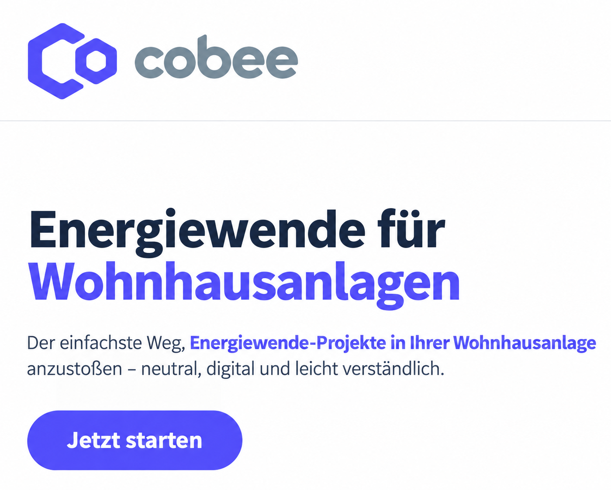
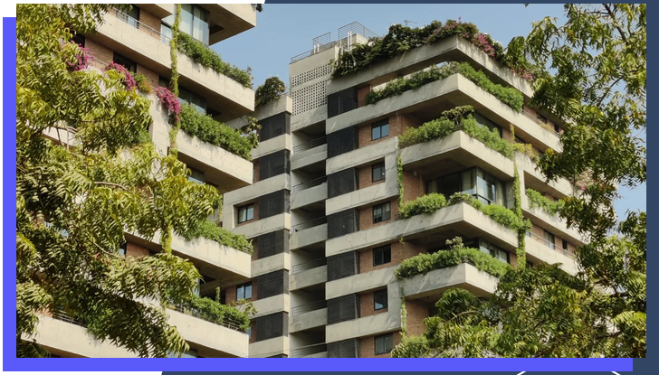

## Ziel und Zielgruppen

Cobee entwickelt einen digitalen Wegbegleiter für den gemeinsamen Umstieg auf erneuerbare Energien in mehrgeschoßigen Wohngebäuden. Er richtet sich an Bewohner:innen, Gebäudeeigentümer:innen, Hausverwaltungen und Bauträger, die Entscheidungen zur Dekarbonisierung gemeinsam vorbereiten und treffen müssen.

## Pilotprojekt und Vorgehen

Eine exemplarische Wiener Wohnhausanlage dient dazu, Erfolgsfaktoren für Planungs- und Entscheidungsprozesse zu untersuchen. Im Mittelpunkt stehen die Errichtung einer Photovoltaikanlage und die Umstellung der Wärmeversorgung von Gas auf erneuerbare Wärme.

Die Erfahrungen bilden die Grundlage für die digitale Prozessbegleitung. Untersucht werden insbesondere drei Fragen:

- Welche Informationen benötigen Wohnungseigentümer:innen zu welchem Zeitpunkt der Planung?
- Welche Form der Informationsvermittlung eignet sich für die jeweiligen Zielgruppen?
- Wie lässt sich der Informations- und Entscheidungsprozess gestalten?

## Verbindung zur Lehre

Das Fallbeispiel wurde in die Lehre eingebunden und durch eine Masterarbeit begleitet. Eine Mitgründerin des Start-ups hat an der FH Technikum Wien studiert.

## Einblicke in das Projekt

::: {.project-gallery}

{fig-alt="Cobee begleitet die Energiewende in Wohnhausanlagen mit einem digitalen Angebot für den gemeinsamen Entscheidungsprozess."}

{fig-alt="Begrünte Balkone und Fassaden eines Wohngebäudes veranschaulichen den Gebäudekontext der gemeinsamen Energiewende."}

:::

## Projektdaten

| Feld | Angabe |
|:--|:--|
| Konsortium / Koordination | cobee solutions GmbH |
| Laufzeit | 10/2023- 12/2025 |

[← Alle Forschungsprojekte](../projects.qmd)
