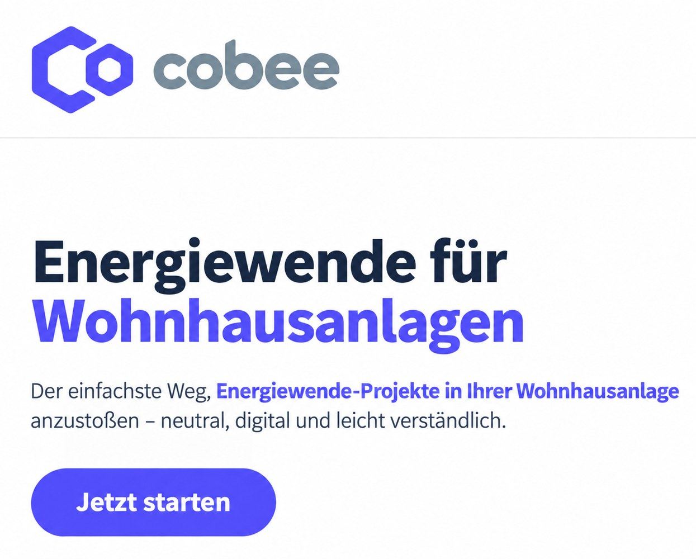

## Worum geht es?

An einer Wiener Wohnhausanlage werden Erfolgsfaktoren für Planungs- und Entscheidungsprozesse zur Dekarbonisierung untersucht. Im Mittelpunkt stehen Informationsbedarf und Beteiligung von Bewohner:innen, Eigentümer:innen und Hausverwaltungen.

::: {.project-figure}

:::

## Vorgehen und dokumentierter Stand

Die Erfahrungen aus dem Pilotprojekt bilden die Grundlage für einen digitalen Wegbegleiter. Das Fallbeispiel wurde in die Lehre und eine Masterarbeit eingebunden.

## Projektdaten

| Feld | Angabe aus dem Poster |
|:--|:--|
| Laufzeit | 10/2023- 12/2025 |
| Projektstatus |  |
| Kontakt | Jens Leibold |
| Beteiligte Organisationseinheiten | Climate-fit Buildings and Districts (Zuordnung im Feld F&E-Schwerpunkt) |

::: {.callout-note}
Die Angaben geben den Stand der bereitgestellten Unterlagen wieder. Eine vergangene Laufzeit allein belegt keinen Projektabschluss. TODO: Aktuellen Stand, vollständige Partnerliste und freigegebene Publikations- bzw. Ergebnislinks ergänzen.
:::

## Quelle

::: {.source-note}
„Projektdarstellung_RES+AuR_velo.pptx“, Folie 6. Redaktionelle Zusammenfassung für diesen Prototyp; Ziele und erwartete Ergebnisse sind keine nachgewiesenen Wirkungen.
:::

[← Alle Forschungsprojekte](../projects.qmd)
