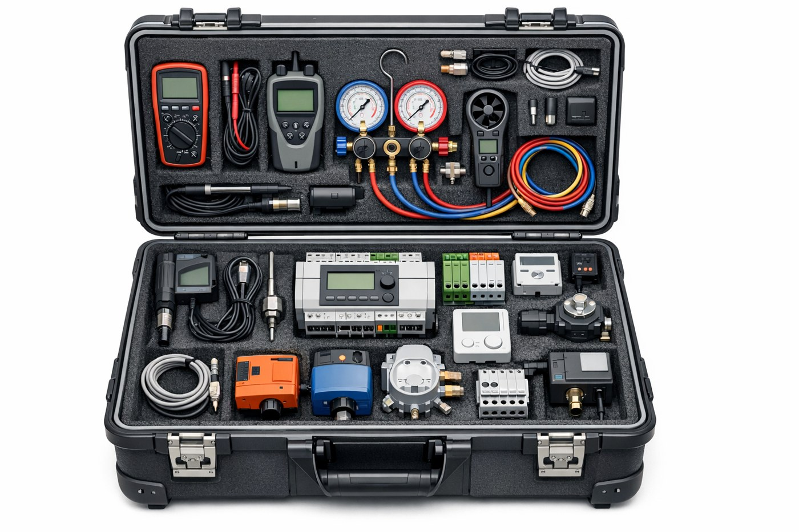

## Worum geht es?

Ein nachrüstbarer Mess- und Regelungskoffer, Monitoring und lernende Regelungsstrategien sollen Flexibilität in Neubau und Bestand erschließen. Komfortbedingungen und sozialwissenschaftliche Begleitforschung sind Teil der Untersuchung.

::: {.project-figure}

:::

## Forschung und Anwendung

Geplant sind Tests an der FH Salzburg, Anwendungen in realen Gebäuden und Geschäftsmodelle für Energiedienstleister.

## Projektdaten

| Feld | Angabe |
|:--|:--|
| Laufzeit | 04/2025 – 03/2030 (60 Monate) |

[← Alle Forschungsprojekte](../projects.qmd)
