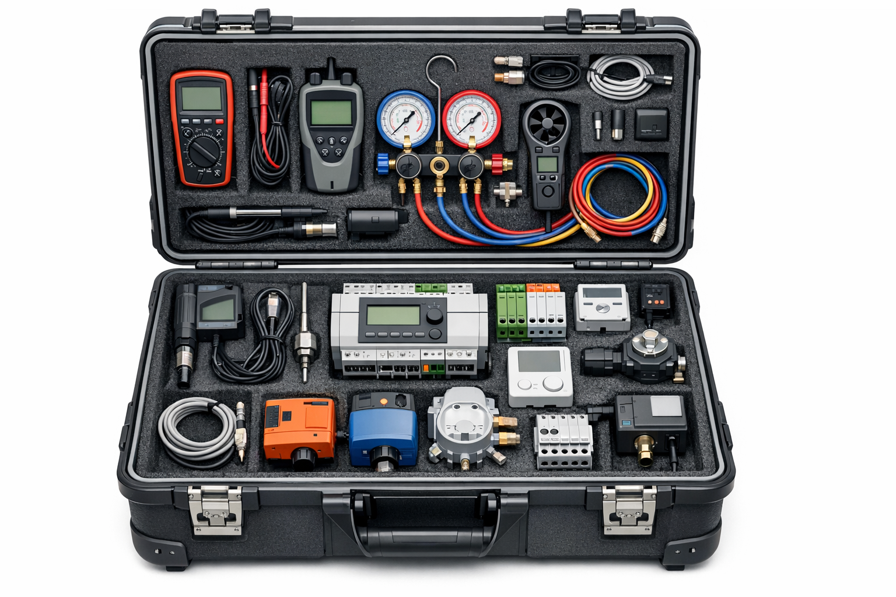
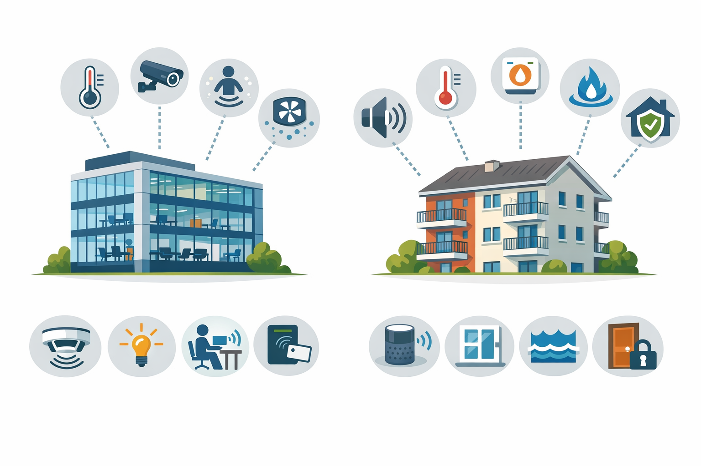

## Ausgangslage und Ziele

Die Nutzung fluktuierender erneuerbarer Energie erfordert Speicherkapazitäten. Gebäudespeichermassen können Wärme und Kälte aufnehmen und zeitversetzt bereitstellen. Dadurch lassen sich Erzeugungs- und Verbrauchsspitzen ausgleichen.

EnerFlexBuildings untersucht eine praktikable und skalierbare Energieflexibilisierung in Neubau und Bestand. Die Aktivierung der Speichermasse soll die jeweiligen Gebäudeeigenschaften und individuellen Komfortanforderungen berücksichtigen.

## Technische Entwicklung und Erprobung

- Einen nachrüstbaren Mess- und Regelungskoffer entwickeln und in Betrieb nehmen.
- System- und Komfortparameter überwachen und Flexibilitätspotenziale analysieren.
- Regelungsstrategien mit Reinforcement Learning entwickeln und trainieren, die Komfortbedingungen berücksichtigen.
- Die Ansätze in den Forschungstesträumen der FH Salzburg testen und validieren.
- Den Einsatz in realen Gebäuden mit Nutzer:innenbefragungen und sozialwissenschaftlicher Forschung begleiten.
- Geschäftsmodelle für Energiedienstleister entwickeln.

## Erwartete Ergebnisse

Das Projekt soll das Flexibilisierungspotenzial von Gebäudespeichermassen quantifizieren und ihren Beitrag zur Netzentlastung nachweisen. Dazu gehört die technische Kommunikation zwischen verfügbarem Flexibilitätspotenzial und dem Bedarf des Energiesystems.

KI- und RL-gestützte Regelungskonzepte sollen in realen Gebäuden umgesetzt werden. Weitere Ziele sind Ansätze zur Auflösung von Konflikten zwischen Netzanforderungen und Nutzer:innenbedürfnissen sowie Geschäftsmodelle für energieflexible Gebäude.

## Forschung und Lehre

Monitoringkampagnen in den Testräumen und die Vorbereitung realer Gebäudeeinsätze verbinden technische Entwicklung mit Anwendung. Lehrveranstaltungen und Abschlussarbeiten greifen die Arbeiten auf. Ein Transfer in wirtschaftsnahe Folgeprojekte ist vorgesehen.

## Einblicke in das Projekt

::: {.project-gallery}

{fig-alt="Illustration eines transportablen Mess- und Regelungskoffers: Unterschiedliche Sensoren und Komponenten werden für den Einsatz im Gebäude zusammengeführt."}

{fig-alt="Illustration vernetzter Gebäudetechnik in Neubau und Bestand. Sensorik, Regelung und Komfortanforderungen bilden die Grundlage für energieflexiblen Betrieb."}

:::

## Projektdaten

| Feld | Angabe |
|:--|:--|
| Konsortium / Koordination | FH Technikum Wien (Koord.), FH Salzburg |
| Laufzeit | 04/2025 – 03/2030 (60 Monate) |

[← Alle Forschungsprojekte](../projects.qmd)
