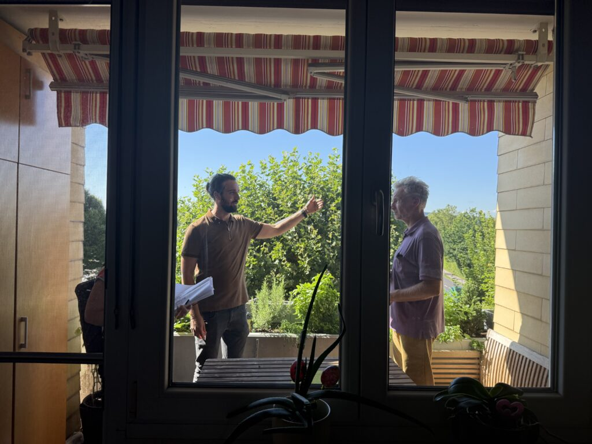
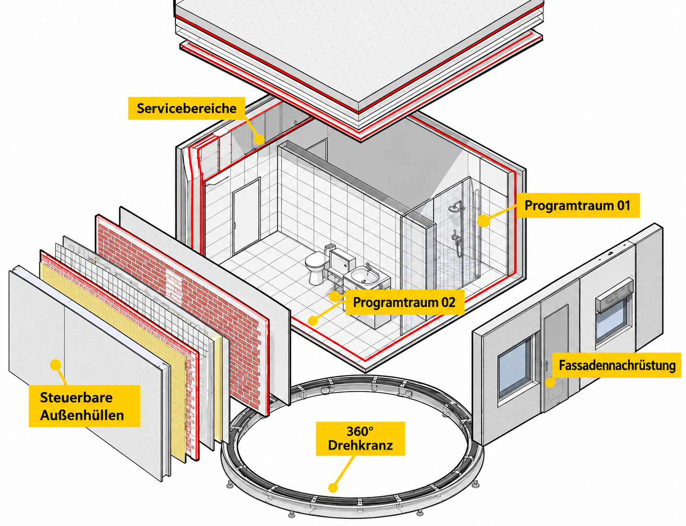
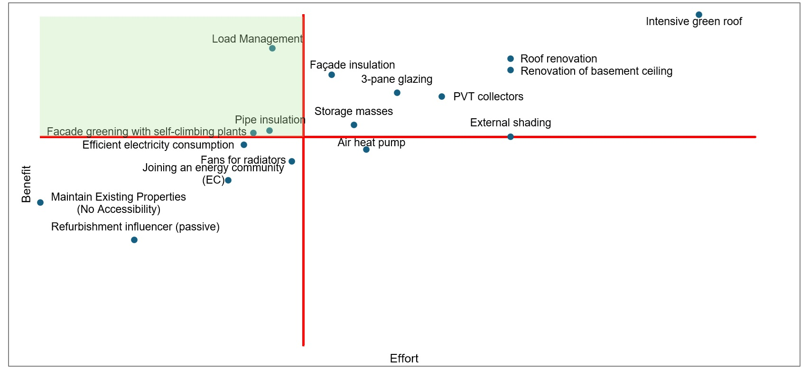

## Ziele

FluccoSAN entwickelt dynamische Sanierungsstrategien, die Energieflexibilität, thermischen Komfort sowie Kosten und Nutzen gemeinsam berücksichtigen. Experimentelle Tests untersuchen Behaglichkeit und Akzeptanz und unterstützen die Ableitung netzdienlicher Betriebsregeln.

Ein ganzheitliches Bewertungskonzept verbindet Klimaneutralität, Resilienz, Kreislauffähigkeit, Energieflexibilität und Treibhausgaswirkungen.

## Vorgehen

1. Sanierungsfälle auswählen und ein Bewertungsmodell mit zugehöriger Matrix entwickeln.
2. Den Gebäudebestand typologisieren und Flexibilitätspotenziale erheben.
3. Die Sanierungsfälle modellieren und dynamisch simulieren.
4. Versuchsdesigns für die Prüfbox entwickeln und durch Tests in realer Umgebung ergänzen.
5. Verhaltensmodelle und Motivationsstrategien ermitteln und gruppieren.
6. Die untersuchten Lösungen bewerten und in einen Sanierungsleitfaden überführen.

## Experimentelle Untersuchung und Bewertung

Tests in realer Umgebung dienen dazu, Verhaltensmodelle zu ermitteln und Sanierungsstrategien zu erproben und umzusetzen. Die ganzheitliche Bewertung einer Pareto-Matrix macht Zielkonflikte zwischen unterschiedlichen Lösungsvarianten sichtbar.

Die Verbindung von Simulation, Prüfbox und Realtests soll technische Flexibilität und die Anforderungen der Nutzer:innen zusammenführen.

## Einblicke in das Projekt

::: {.project-gallery}

{fig-alt="Experimentelle Untersuchung an einem Fenster: Die Versuche verbinden reale Umgebungsbedingungen mit Fragen des thermischen Komforts."}

{fig-alt="Aufbau der Prüfbox mit Servicebereichen, steuerbaren Außenhüllen und Durchführungen für das Versuchsprogramm."}

{fig-alt="Qualitative Gegenüberstellung von Aufwand und Nutzen verschiedener Maßnahmen. Lastmanagement, Dämmung, Speicher, Verschattung und erneuerbare Versorgung werden in einer gemeinsamen Matrix eingeordnet; die Grafik zeigt keine allgemeingültigen Zahlenwerte."}

:::

## Projektdaten

| Feld | Angabe |
|:--|:--|
| Konsortium / Koordination | FH Technikum Wien, IBO, Renowave, Kleboth & Dollnig, Käferhaus |
| Laufzeit | 36 Monate |

[← Alle Forschungsprojekte](../projects.qmd)
