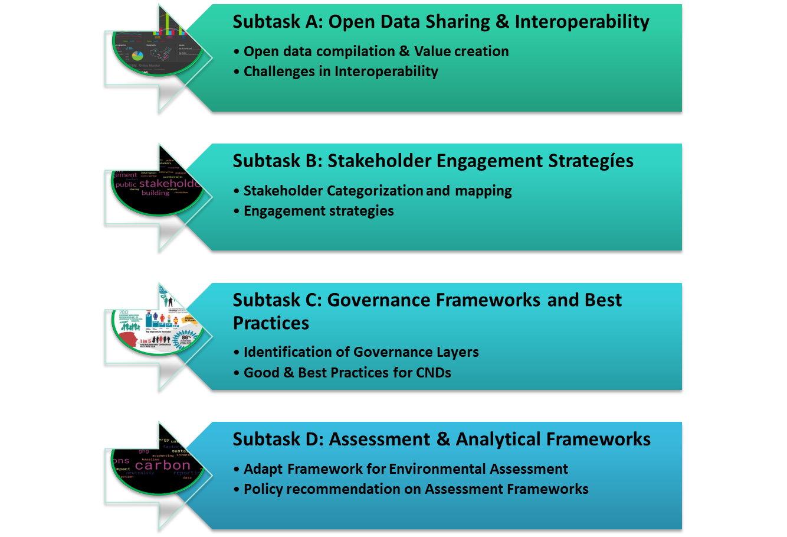
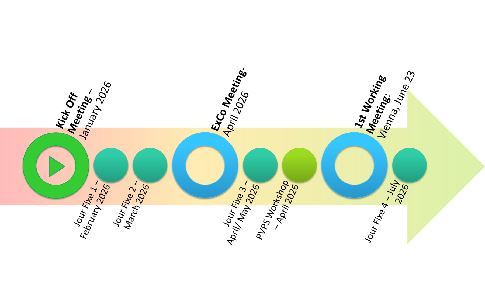

## Klimaneutrale Quartiere praktisch entwickeln

IEA Cities TCP Task 4 entwickelt und adaptiert Methoden und Rahmenkonzepte für Climate Neutral Districts. Im Zentrum steht ihre Anwendung in der konkreten Quartiersplanung.

## Ziele und Vorgehen

- Werkzeuge, Methoden, Rahmenkonzepte und Erfahrungen für die praktische Planung sammeln.
- Methoden und Werkzeuge anhand konkreter Anwendungsfälle bewerten.
- Relevante Stakeholder identifizieren, kategorisieren und ihre Beziehungen abbilden.
- Passende Beteiligungsstrategien entwickeln.
- Rahmenkonzepte und Empfehlungen für die Quartiersentwicklung anpassen.
- Validierte Methoden durch Berichte, Workshops und weitere Kommunikationsformate verbreiten.

## Vier Arbeitsbereiche

| Arbeitsbereich | Inhalt |
|:--|:--|
| A · Offene Daten | Städtische Daten gemeinsam nutzen und Herausforderungen der Interoperabilität bearbeiten. |
| B · Beteiligung | Stakeholder kategorisieren und geeignete Strategien zur Einbindung entwickeln. |
| C · Governance | Steuerungsebenen analysieren und einen Katalog guter Praxis aufbauen. |
| D · Bewertung | Methodische Rahmenbedingungen zur Bewertung von Klimaneutralität entwickeln. |

## Zusammenarbeit und Transfer

Der Task ist auf internationale Zusammenarbeit und den Austausch praktischer Erfahrungen ausgerichtet. Das österreichische Konsortium verbindet die FH Technikum Wien mit AIT, e7 und AEE INTEC.

## Einblicke in das Projekt

::: {.project-gallery}

{fig-alt="Die vier Teilaufgaben verbinden offene Daten und Interoperabilität, Stakeholderbeteiligung, Governance sowie methodische und analytische Bewertungsrahmen."}

{fig-alt="Zeitliche Entwicklung des Cities TCP: Die Darstellung ordnet Aufgaben und Meilensteine entlang eines gemeinsamen Entwicklungspfads ein."}

:::

## Projektdaten

| Feld | Angabe |
|:--|:--|
| Koordination / Partner | FH Technikum Wien / AIT, E7, AEE INTEC |
| Laufzeit | 01/2026 - 09/2029 |

[← Alle Forschungsprojekte](../projects.qmd)
