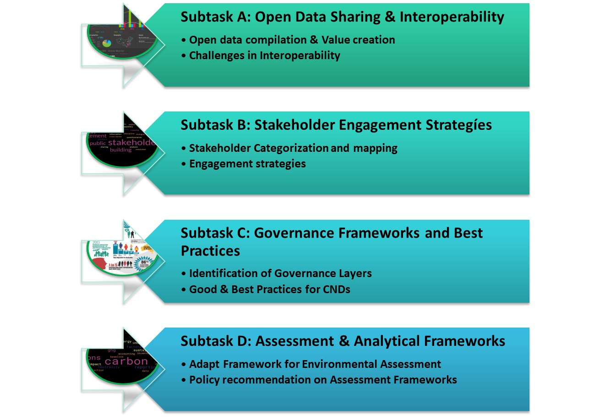

## Worum geht es?

Der Task untersucht offene städtische Daten und Interoperabilität, Beteiligungsstrategien, Governance und Methoden zur Bewertung von Klimaneutralität. Werkzeuge und Erfahrungen sollen für konkrete Planungsfälle bewertet und angepasst werden.

::: {.project-figure}

:::

## Vorgehen und dokumentierter Stand

Validierte Methoden sollen über Berichte, Workshops und weitere Medien verbreitet werden; das Poster beschreibt diese als erwartete Ergebnisse.

## Projektdaten

| Feld | Angabe aus dem Poster |
|:--|:--|
| Laufzeit | 01/2026 - 09/2029 |
| Projektstatus |  |
| Kontakt | Dr.techn. Karthik Bhat, M.Sc. |
| Beteiligte Organisationseinheiten | Climate-fit Buildings and Districts (Zuordnung im Feld F&E-Schwerpunkt) |

::: {.callout-note}
Die Angaben geben den Stand der bereitgestellten Unterlagen wieder. Eine vergangene Laufzeit allein belegt keinen Projektabschluss. TODO: Aktuellen Stand, vollständige Partnerliste und freigegebene Publikations- bzw. Ergebnislinks ergänzen.
:::

## Quelle

::: {.source-note}
„Projektdarstellung_RES+AuR_velo.pptx“, Folie 19. Redaktionelle Zusammenfassung für diesen Prototyp; Ziele und erwartete Ergebnisse sind keine nachgewiesenen Wirkungen.
:::

[← Alle Forschungsprojekte](../projects.qmd)
