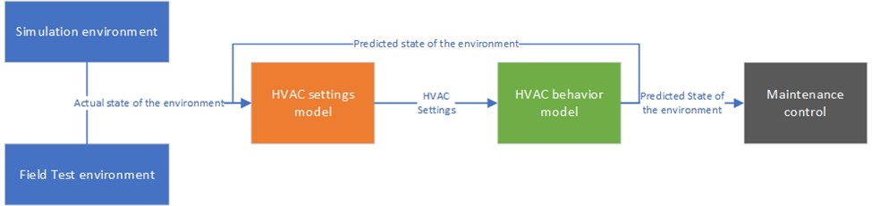

## Worum geht es?

Im Fokus stehen Predictive Maintenance für Lüftungsanlagen, Simulation, Sensorik und Monitoring im Realbetrieb. Lebenszyklusanalysen und Lebenszykluskosten ergänzen die technische Optimierung.

::: {.project-figure}

:::

## Forschung und Anwendung

Fünf Regellogiken wurden in der Simulation implementiert. Untersucht wird der Zielkonflikt zwischen Komfort und Energieeinsparung.

## Projektdaten

| Feld | Angabe |
|:--|:--|
| Laufzeit | 36 Monate |

[← Alle Forschungsprojekte](../projects.qmd)
