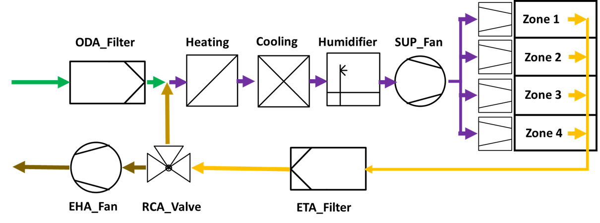

## Ziele

KI4HVACS untersucht die Energieeffizienz von Heizungs-, Lüftungs- und Klimasystemen durch prädiktive Algorithmen und Modellbildung mit maschinellem Lernen. Der Schwerpunkt liegt auf **Predictive Maintenance**, also vorausschauender Wartung von Lüftungsanlagen.

KI soll sowohl in Bestands- als auch in Neuanlagen eingesetzt werden. Das Projekt ermittelt Energieeinsparpotenziale, trainiert eine Reinforcement-Learning-Logik mithilfe von TRNSYS und vergleicht vorausschauende mit aufgeschobener Wartung auch aus Lebenszyklusperspektive.

## Arbeitsschritte

1. Die Systemarchitektur definieren.
2. Die mindestens erforderliche Sensorik für vorausschauende Wartung ermitteln.
3. Simulationen erstellen und eine Messinfrastruktur aufbauen.
4. Die Systemoptimierung in den Anlagenbetrieb einbinden.
5. Das Verhalten im Realbetrieb überwachen.
6. Lebenszyklusanalysen und Lebenszykluskosten berechnen.

## Erkenntnisse

Fünf Regellogiken wurden in der Simulation implementiert, um reale Betriebsbedingungen abzubilden. Viele Lüftungsanlagen verfügen bereits über relevante Sensorik: Temperatur, Druckdifferenz, Feuchte und Stromaufnahme.

Die untersuchten Regelungsansätze zeigen einen möglichen Rückgang des Primärenergiebedarfs um **rund 4,5 %**. Die Einsparung ist im Zusammenhang mit dem erforderlichen Kompromiss zwischen Komfort und Energieeinsatz zu betrachten; sie ist keine allgemeine Garantie für beliebige Anlagen.

## Einblicke in das Projekt

::: {.project-gallery}

{fig-alt="Schema der Lüftungsanlage mit Filtern, Heizung, Kühlung, Befeuchtung, Ventilatoren und vier versorgten Zonen."}

{fig-alt="Regelkreis der Systemoptimierung: Testumgebung, Regelungsagent und Wartungsmodell tauschen Beobachtungen und Steuerungsinformationen aus."}

:::

## Projektdaten

| Feld | Angabe |
|:--|:--|
| Konsortium / Koordination | FH Technikum Wien, TU Wien, Donau Uni Krems, Radel & Hahn, Reisenbauer Solutions |
| Laufzeit | 36 Monate |

[← Alle Forschungsprojekte](../projects.qmd)
