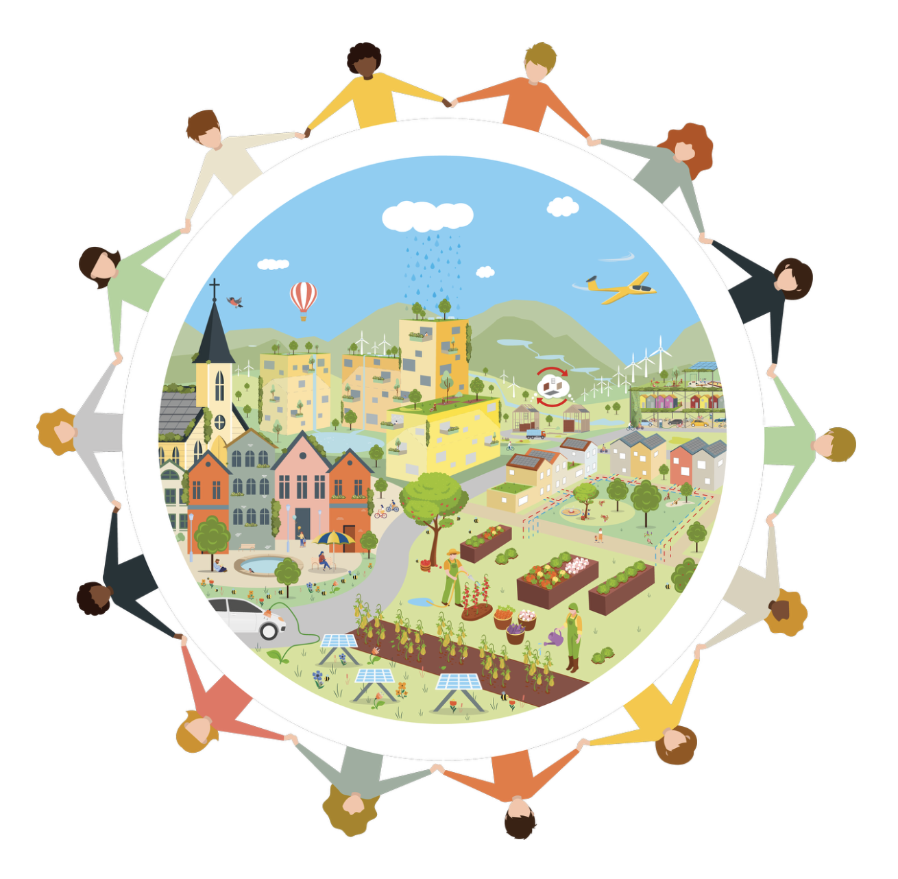
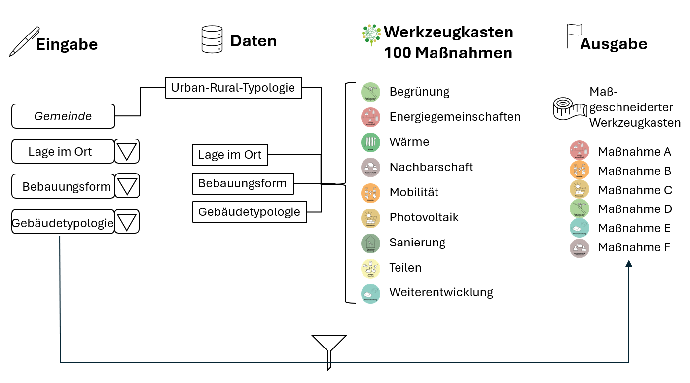

## Von der Energie- zur Klimagemeinschaft

Klimagemeinschaften unterstützt kleinere und mittlere Gemeinden sowie städtische Quartiere mit ganzheitlichen, gebäudeübergreifenden Sanierungslösungen. Im Mittelpunkt stehen Nachbarschaften, die Ressourcen bündeln und Maßnahmen gemeinsam umsetzen.

## Quartierstypologien und Maßnahmen

- Quartiere nach städtebaulichen, baulichen, energetischen, ökologischen und sozialen Kriterien typologisieren.
- Quartierstypen im Gemeindegebiet identifizieren, unter anderem mit Unterstützung künstlicher Intelligenz.
- Erprobte Maßnahmen aus Beispielquartieren in einem Werkzeugkoffer beschreiben.
- Maßnahmen nach Bedarf und Umsetzbarkeit den Quartierstypologien zuordnen.
- Ein Assistenzsystem zur Auswahl geeigneter Maßnahmen und zur überschlägigen Berechnung von Kosten und Nutzen entwickeln.

Der Maßnahmenkatalog umfasst Umwelt, Energie, Lebensqualität, Mobilität und Wirtschaft. Dazu gehören Wärmeversorgung, Photovoltaik, Energiegemeinschaften, thermische Sanierung, Begrünung und Entsiegelung ebenso wie Nachbarschaft, gemeinsames Nutzen und die Weiterentwicklung von Gebäuden.

## Assistenzsystem und Bewertung

Das Assistenzsystem verortet Quartierstypologien in Gemeinden und verknüpft sie mit dem Werkzeugkoffer. Automatisierte Lebenszyklusanalysen und Lebenszykluskostenrechnungen ergänzen die Auswahl um eine ökologische und wirtschaftliche Bewertung.

Für das letzte Projektjahr sind Tests des Assistenzsystems an Beispielquartieren vorgesehen.

## Einblicke in das Projekt

::: {.project-gallery}

{fig-alt="Klimagemeinschaften verbinden Menschen und Maßnahmen auf der Ebene von Nachbarschaften und Quartieren."}

{fig-alt="Ablauf des Assistenzsystems: Eingaben zu Lage, Bebauung und Gebäudetyp werden mit Quartierstypologien und einem Werkzeugkasten mit 100 Maßnahmen verknüpft. Daraus entsteht eine passende Maßnahmengruppe."}

:::

## Projektdaten

| Feld | Angabe |
|:--|:--|
| Konsortium / Koordination | FH Technikum Wien, IBO, Wohnbund, renowave, Kleboth & Dollnig, SIMA |
| Laufzeit | 01.09.2023 – 30.08.2027 (48 Monate) |

[← Alle Forschungsprojekte](../projects.qmd)
