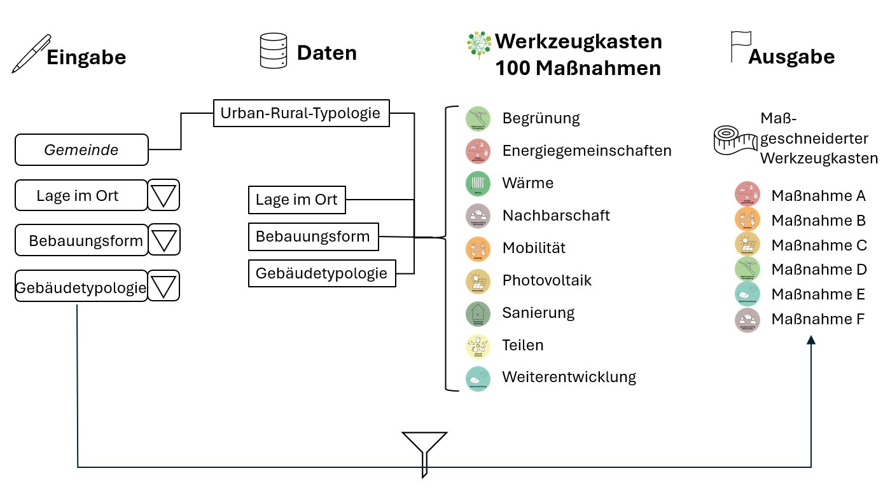

## Worum geht es?

Quartierstypologien werden mit erprobten Maßnahmen zu Umwelt, Energie, Lebensqualität, Mobilität und Wirtschaft verknüpft. Ein Assistenzsystem soll passende Maßnahmen auswählen und Kosten sowie Nutzen abschätzen.

::: {.project-figure}

:::

## Vorgehen und dokumentierter Stand

Das Poster beschreibt die Entwicklung des Assistenzsystems und automatisierter ökologischer und wirtschaftlicher Bewertungen. Tests an Beispielquartieren sind für das letzte Projektjahr vorgesehen.

## Projektdaten

| Feld | Angabe aus dem Poster |
|:--|:--|
| Laufzeit | 48 Monate (01.09.2023 – 30.08.2027) |
| Projektstatus |  |
| Kontakt | Dipl.Ing. Thomas Zelger (zelger@technikum-wien.at) |
| Beteiligte Organisationseinheiten | CFBD, RES, AIDA |

::: {.callout-note}
Die Angaben geben den Stand der bereitgestellten Unterlagen wieder. Eine vergangene Laufzeit allein belegt keinen Projektabschluss. TODO: Aktuellen Stand, vollständige Partnerliste und freigegebene Publikations- bzw. Ergebnislinks ergänzen.
:::

## Quelle

::: {.source-note}
„Projektdarstellung_RES+AuR_velo.pptx“, Folie 23. Redaktionelle Zusammenfassung für diesen Prototyp; Ziele und erwartete Ergebnisse sind keine nachgewiesenen Wirkungen.
:::

[← Alle Forschungsprojekte](../projects.qmd)
