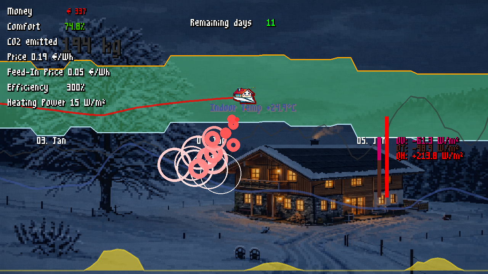
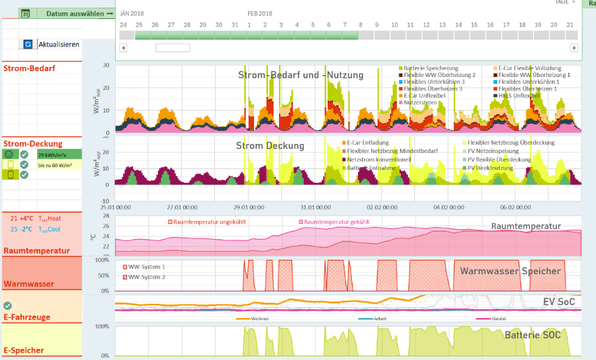

## Klimafitte Stadtsanierung in der Lehre

Die Sanierung des urbanen Gebäudebestands verlangt Fachkräfte, die technische, räumliche, soziale und wirtschaftliche Fragen gemeinsam bearbeiten. KlimSta stärkt diese Schnittstellenkompetenzen durch praxisnahe und interdisziplinäre Lehre.

Studierende lernen, Bestandsquartiere als komplexe urbane Systeme zu analysieren, zu simulieren und weiterzuentwickeln.

## Lehrveranstaltungen und wissenschaftliche Ergebnisse

Zu den Ergebnissen gehören **fünf wissenschaftliche Publikationen** und neue beziehungsweise weiterentwickelte Lehrveranstaltungen, darunter:

- Quartiersbetrachtung.
- Innovative Stadtentwicklung.
- Klimafitte Gebäudekonzepte.
- Advanced Modelling and Simulation.

## Werkzeuge und Lernspiele

### PEExcel

PEExcel unterstützt die Modellierung, Simulation und Analyse klimaneutraler Quartiere. Betrieb, Alltagsmobilität und graue Energie werden gemeinsam betrachtet, um realitätsnahe Quartiersanalysen zu ermöglichen.

### The Renovation Game

Das Serious Boardgame bietet einen spielerischen Zugang zu Maßnahmen, Zielkonflikten und Entscheidungsprozessen bei der Sanierung urbaner Bestandsgebäude.

### PassyBUIRD

Das Lernspiel verbindet Gebäudephysik, Komfort, Energiebedarf, Photovoltaikerzeugung, Kosten und Demand-Side-Management in einer einfachen Spielmechanik.

## Einblicke in das Projekt

::: {.project-gallery}

{fig-alt="The Renovation Game: Spielplan und Maßnahmenkarten machen Sanierungsentscheidungen und ihre Wechselwirkungen gemeinsam diskutierbar."}

{fig-alt="PassyBUIRD verbindet eine spielerische Umgebung mit Kennwerten zu Energie, Emissionen, Kosten und Gebäudebetrieb."}

{fig-alt="PEExcel stellt zeitliche Verläufe von Bedarf und Versorgung dar und macht unter anderem Speicherzustände und Wärmepumpenbetrieb sichtbar."}

{fig-alt="Quartiersanalyse mit 84 Wohn- und Mischnutzungstypologien für City Energy Analyst. Die Darstellung verbindet Typologieentwicklung, Validierung, Sanierungspotenziale nach Alter und Kompaktheit sowie Szenarien für Heizbedarf, Primärenergie und Treibhausgasemissionen. Die dargestellte Fallanalyse zeigt, dass das ambitionierte Plusenergieziel auch mit zusätzlichen Maßnahmen nicht erreicht wird."}

:::

## Projektdaten

| Feld | Angabe |
|:--|:--|
| Laufzeit | 3/2024- 8/2026 |

[← Alle Forschungsprojekte](../projects.qmd)
