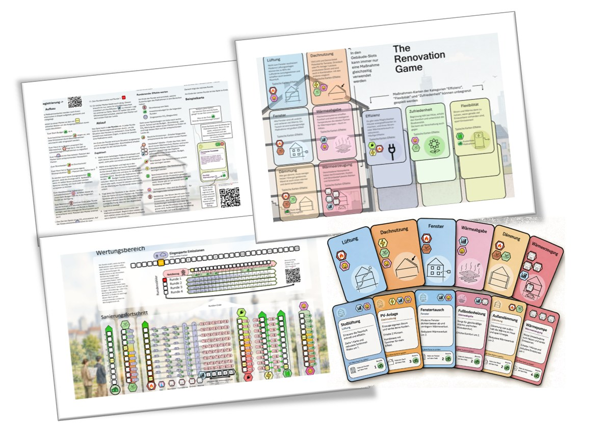

## Worum geht es?

Studierende analysieren und simulieren Bestandsquartiere als urbane Systeme. Das Kompetenzteam verbindet technische, räumliche, soziale und wirtschaftliche Perspektiven auf die Sanierung.

::: {.project-figure}

:::

## Vorgehen und dokumentierter Stand

Das Poster nennt weiterentwickelte Lehrveranstaltungen, PEExcel zur Quartiersanalyse und die Lernspiele „The Renovation Game“ und „PassyBUIRD“.

## Projektdaten

| Feld | Angabe aus dem Poster |
|:--|:--|
| Laufzeit | 3/2024- 8/2026 |
| Projektstatus |  |
| Kontakt | Simon Schneider (simon.schneider@technikum-wien.at) |
| Beteiligte Organisationseinheiten | FIE, FEE; CBD-Zuordnung über den ausgeschriebenen F&E-Schwerpunkt |

::: {.callout-note}
Die Angaben geben den Stand der bereitgestellten Unterlagen wieder. Eine vergangene Laufzeit allein belegt keinen Projektabschluss. TODO: Aktuellen Stand, vollständige Partnerliste und freigegebene Publikations- bzw. Ergebnislinks ergänzen.
:::

## Quelle

::: {.source-note}
„Projektdarstellung_RES+AuR_velo.pptx“, Folie 24. Redaktionelle Zusammenfassung für diesen Prototyp; Ziele und erwartete Ergebnisse sind keine nachgewiesenen Wirkungen.
:::

[← Alle Forschungsprojekte](../projects.qmd)
