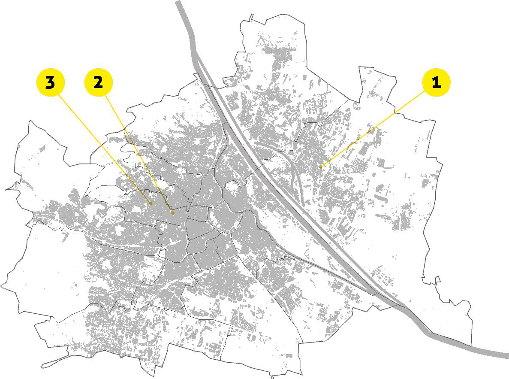
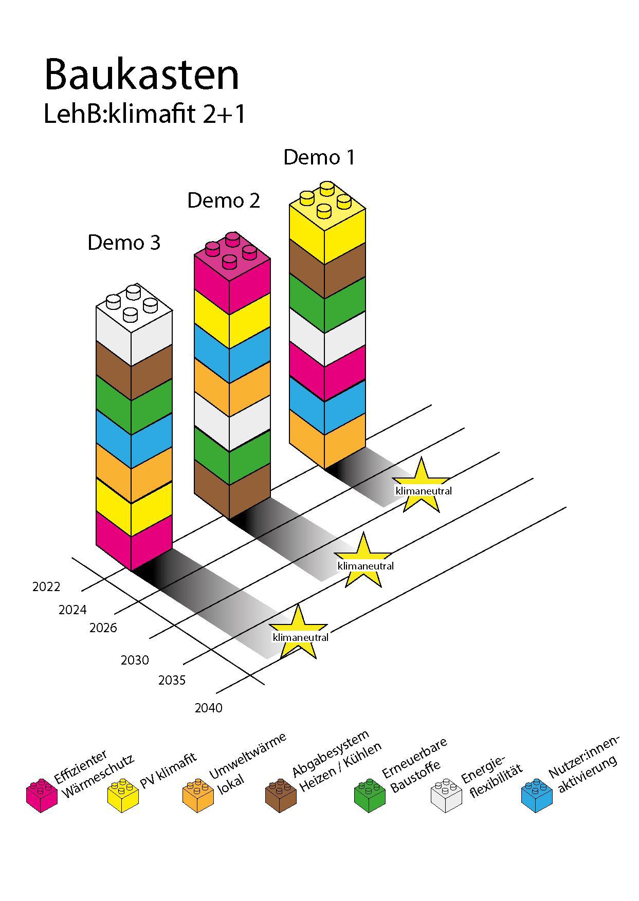

## Von der Sondierung zur Umsetzung

LehB:KlimafitDemo2+1 überführt die Ergebnisse von [LehB:Klimafit!](lehb-klimafit.qmd) in prototypische, klimafitte und sozialverträgliche Sanierungslösungen. Maßgeblich sind lokale Anforderungen an Klimaneutralität 2040.

Die Begleitforschung verbindet die Rahmenbedingungen der Wohnungsgemeinnützigkeit, Nutzer:innen als Alltagsexpert:innen und die Perspektive städtischer Stakeholder.

## Drei Demonstrationsobjekte

| Demonstration | Schwerpunkt |
|:--|:--|
| Rugierstraße | Monitoring mit besonderem Augenmerk auf den sommerlichen thermischen Komfort. |
| Degengasse | Stufenweiser Sanierungsplan einschließlich Kostenschätzung. |
| Friedrich-Kaiser-Gasse | Untersuchung von Low-Tech-Maßnahmen. |

## Umsetzung und Begleitforschung

Die Umsetzung und das Monitoring der drei Objekte werden mit Voruntersuchungen und begleitender Forschung verknüpft. Bewohner:innen und städtische Stakeholder wirken an der Abstimmung mit. Lehrveranstaltungen und Abschlussarbeiten greifen die Arbeiten auf.

## Erwartete Ergebnisse

- Prototypisch umgesetzte, klimafitte und sozialverträgliche Sanierungslösungen.
- Erkenntnisse aus dem Monitoring, insbesondere zum sommerlichen Komfort.
- Ein stufenweiser Sanierungsplan mit Kostenschätzung.
- Ein Katalog von Low-Tech-Maßnahmen.
- Übertragbare Lösungen für Bestandssanierungen in der Wohnungsgemeinnützigkeit.

## Einblicke in das Projekt

::: {.project-gallery}

{fig-alt="Lage der drei Demonstrationsobjekte im Wiener Stadtgebiet. Die nummerierten Markierungen verbinden die Standorte mit den jeweiligen Untersuchungsschwerpunkten."}

{fig-alt="Baukastensystem für die drei Demonstrationen: Unterschiedliche Maßnahmen werden zu standortspezifischen Sanierungspaketen kombiniert."}

:::

## Projektdaten

| Feld | Angabe |
|:--|:--|
| Konsortium / Koordination | wohnbund:consult eG (Koord.), IIBW, FH Technikum Wien, UIV, immo 360 grad, IBO, RENOWAVE.AT, Käferhaus, ÖSW |
| Laufzeit | 09/2024 – 08/2027 (36 Monate) |

[← Alle Forschungsprojekte](../projects.qmd)
