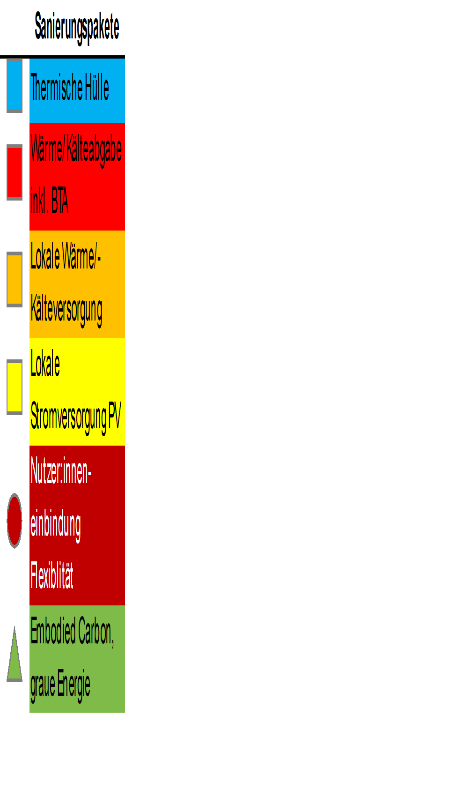

## Ziele der Sondierung

„Lebe heute im Bestand: Zusammen klimafit“ untersucht übertragbare Sanierungskonzepte für den gemeinnützigen Wohnbau auf dem Weg zur Klimaneutralität 2040. Drei Perspektiven stehen im Mittelpunkt:

- Rechtlich und wirtschaftlich tragfähige Systemlösungen mit hoher Umsetzungswahrscheinlichkeit.
- Akzeptanz, sozialräumliche Begleitung und Energiearmut aus Sicht der Nutzer:innen.
- Entscheidungsgrundlagen für Politik und Verwaltung, einschließlich einer angemessenen Aufteilung der Beiträge zur Klimaneutralität.

## Methodik

Technische, ökologische, zirkuläre und sozialräumliche Bestandsanalysen werden mit Beispielen guter Praxis verbunden. Die Quartiersziele berücksichtigen die Plusenergie-Systemgrenzen **Alpha (Betrieb), Beta (Mobilität) und Omega (graue Energie)**.

Ein Baukastensystem kombiniert Gebäudehülle, Wärmeversorgung, lokale Energieerzeugung, PV/PVT und Flexibilität. Ein partizipativer Leitfaden sowie Befragungen von Bewohner:innen und Hausverwaltungen unterstützen die Sanierungsbegleitung.

Dynamische Gebäudesimulationen, Lebenszyklusanalysen über **50 Jahre** und Lebenszykluskosten bilden die Grundlage für ein- oder mehrstufige Sanierungsfahrpläne bis 2040.

## Ergebnisse

Das abgeschlossene Projekt untersuchte Sanierungspakete an **sechs realen Gebäudeensembles** aus Bauperioden von etwa **1959 bis 1997**. Zielkompatible Gesamtlösungen können ein- oder mehrstufig umgesetzt werden; einstufige Lösungen setzen insbesondere ausreichende Rücklagen voraus.

Die Quartierszielwerte berücksichtigen die bauliche Dichte und wurden mit klimaaktiv abgestimmt. In den untersuchten Varianten zeigten sich die thermische Hüllensanierung und die Umstellung der Wärmeversorgung als größte Hebel. Photovoltaik war in allen betrachteten Varianten wirtschaftlich, mit Amortisationszeiten von **vier bis sechs Jahren**.

Eine innovative Deckenstreifenheizung und -kühlung aktiviert das Speichervermögen für sommerlichen Komfort und Netzdienlichkeit. Bewohner:innen werden als Alltagsexpert:innen einbezogen; Energiearmut und sommerlicher Komfort sind zentrale Themen.

Weitere Ergebnisse betreffen Wirtschaftlichkeit, Förderlücken und Geschäftsmodelle, unter anderem EAG-Energiegemeinschaften. Die Sondierung wird im [Demonstrationsprojekt LehB:KlimafitDemo2+1](lehb-demo.qmd) weitergeführt.

## Einblicke in das Projekt

::: {.project-gallery}

{fig-alt="Schrittweise Sanierungspfade bis 2040: Die drei Demonstrationslinien unterscheiden klimafitte, energetische und Low-Tech-Maßnahmen und zeigen deren zeitliche Kombination."}

{fig-alt="Legende der Sanierungspakete: Gebäudehülle, Wärme- und Kälteabgabe, lokale Energieversorgung, Photovoltaik, Beteiligung und Flexibilität sowie graue Energie."}

:::

## Projektdaten

| Feld | Angabe |
|:--|:--|
| Konsortium / Koordination | FH Technikum Wien (Koord.), wohnbund:consult, IBO, Urban Innovation Vienna, renowave.at, Käferhaus |
| Laufzeit | 07/2022 – 06/2023 (12 Monate, abgeschlossen) |

[← Alle Forschungsprojekte](../projects.qmd)
