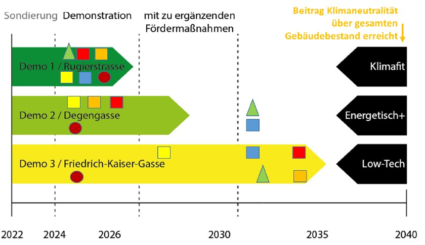

## Worum geht es?

Die Sondierung kombiniert technische Bestandsanalysen, Lebenszyklusbewertung, Kosten und sozialräumliche Begleitung. Sanierungsfahrpläne beziehen Betrieb, Mobilität und graue Energie ein.

::: {.project-figure}

:::

## Vorgehen und dokumentierter Stand

Laut Poster wurde ein Baukastensystem an sechs Gebäudeensembles untersucht. Die Ergebnisse fließen in das Demonstrationsprojekt LehB:KlimafitDemo2+1 ein.

## Projektdaten

| Feld | Angabe aus dem Poster |
|:--|:--|
| Laufzeit | 07/2022 – 06/2023 (12 Monate, abgeschlossen) |
| Projektstatus |  |
| Kontakt | Thomas Zelger |
| Beteiligte Organisationseinheiten | KFCBD, KFRES |

::: {.callout-note}
Die Angaben geben den Stand der bereitgestellten Unterlagen wieder. Eine vergangene Laufzeit allein belegt keinen Projektabschluss. TODO: Aktuellen Stand, vollständige Partnerliste und freigegebene Publikations- bzw. Ergebnislinks ergänzen.
:::

## Quelle

::: {.source-note}
„Projektdarstellung_RES+AuR_velo.pptx“, Folie 25. Redaktionelle Zusammenfassung für diesen Prototyp; Ziele und erwartete Ergebnisse sind keine nachgewiesenen Wirkungen.
:::

[← Alle Forschungsprojekte](../projects.qmd)
