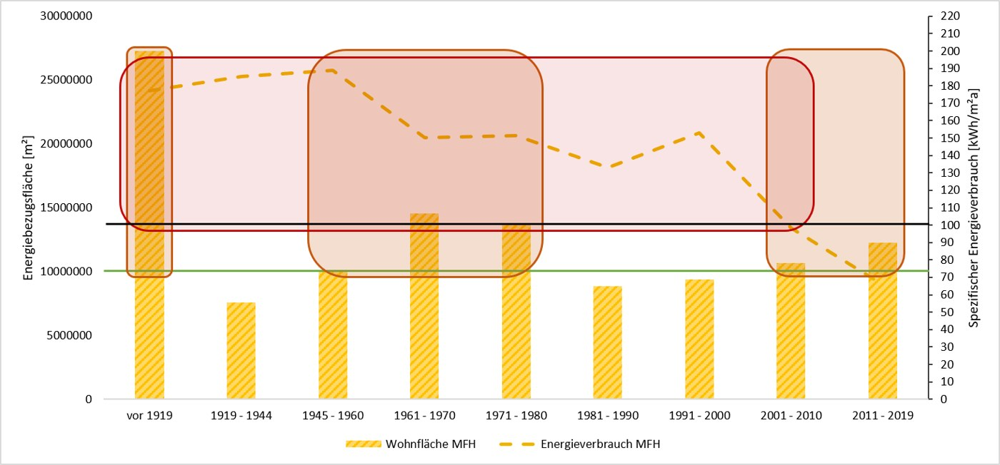

## Worum geht es?

Repräsentative Gebäudetypen, thermischer Komfort und Nutzer:innenbegleitung bilden die Grundlage für Dekarbonisierungspakete. Dynamische Simulationen und Lebenszyklusanalysen unterstützen die Optimierung.

::: {.project-figure}

:::

## Vorgehen und dokumentierter Stand

Die im Poster genannten Einsparungen sind Zielgrößen des Projekts. Umsetzung und Monitoring sollen die entwickelten Maßnahmen untersuchen; validierte Resultate sind noch zu ergänzen.

## Projektdaten

| Feld | Angabe aus dem Poster |
|:--|:--|
| Laufzeit | Januar 2026 bis August 2028, 31 Monate |
| Projektstatus |  |
| Kontakt | Edit Paráda, BSc MSc edit.parada@technikum-wien.at |
| Beteiligte Organisationseinheiten | CBD, RES |

::: {.callout-note}
Die Angaben geben den Stand der bereitgestellten Unterlagen wieder. Eine vergangene Laufzeit allein belegt keinen Projektabschluss. TODO: Aktuellen Stand, vollständige Partnerliste und freigegebene Publikations- bzw. Ergebnislinks ergänzen.
:::

## Quelle

::: {.source-note}
„Projektdarstellung_RES+AuR_velo.pptx“, Folie 27. Redaktionelle Zusammenfassung für diesen Prototyp; Ziele und erwartete Ergebnisse sind keine nachgewiesenen Wirkungen.
:::

[← Alle Forschungsprojekte](../projects.qmd)
