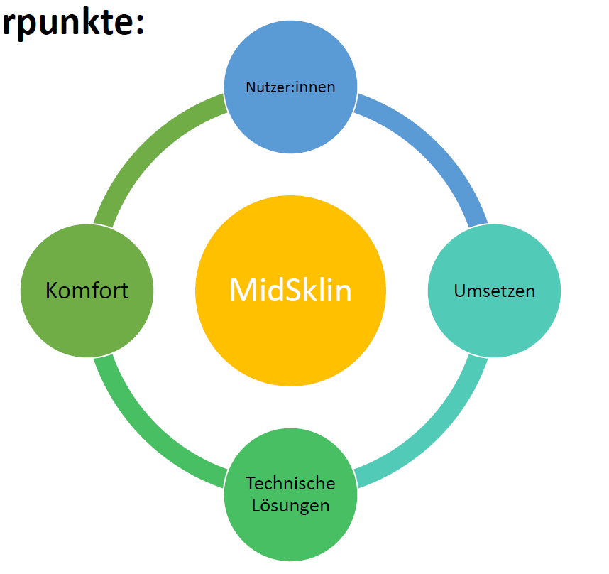

## Motivation und Ziel

MiDSKliN untersucht minimalinvasive dynamische Sanierungen, die Klimawandelanpassung, CO₂-Reduktion und Netzdienlichkeit bis 2040 verbinden. Zunehmende Hitzebelastung in Städten macht dabei den thermischen Komfort zu einem zentralen Kriterium.

Das Projekt verfolgt das Ziel, mit ausgewählten Maßnahmen und Technologien **rund 80 % der CO₂-Emissionen bei etwa 20 % der Kosten einer Vollsanierung** einzusparen. Diese Größen beschreiben das Forschungsziel.

## Gebäudetypen und Skalierung

Eine Typologisierung und Bedarfserhebung identifiziert Skalierungspotenziale und repräsentative Gebäudetypen. Darauf aufbauend werden passende Dekarbonisierungspakete entwickelt.

## Entwicklung und Bewertung

- Die Bandbreite thermischen Komforts und geschlechtsspezifische Unterschiede im Komfortempfinden analysieren.
- Nutzer:innen während der Entwicklung begleiten.
- Dekarbonisierungspakete mithilfe dynamischer Simulationen entwickeln.
- Komfort- und CO₂-optimierte Heizlastberechnungen sowie energieoptimierte Kühlstrategien untersuchen.
- Systeme optimieren und ihre zukünftige Netzintegration berücksichtigen.
- Die optimierten Pakete über den Lebenszyklus bewerten.
- Maßnahmen implementieren und durch Monitoring untersuchen.

## Einblicke in das Projekt

::: {.project-gallery}

{fig-alt="Mehrfamilienhausbestand nach Bauperioden: Balken zeigen Energiebezugsflächen, die gestrichelte Kurve den spezifischen Energieverbrauch. Hervorgehobene Bereiche unterstützen die Auswahl relevanter Gebäudetypen."}

{fig-alt="Die Forschung verbindet Nutzer:innen, Komfort, technische Lösungen und Umsetzung in einem gemeinsamen Entwicklungsprozess."}

:::

## Projektdaten

| Feld | Angabe |
|:--|:--|
| Konsortium / Koordination | RENOWAVE.AT eG. |
| Laufzeit | Januar 2026 bis August 2028, 31 Monate |

[← Alle Forschungsprojekte](../projects.qmd)
