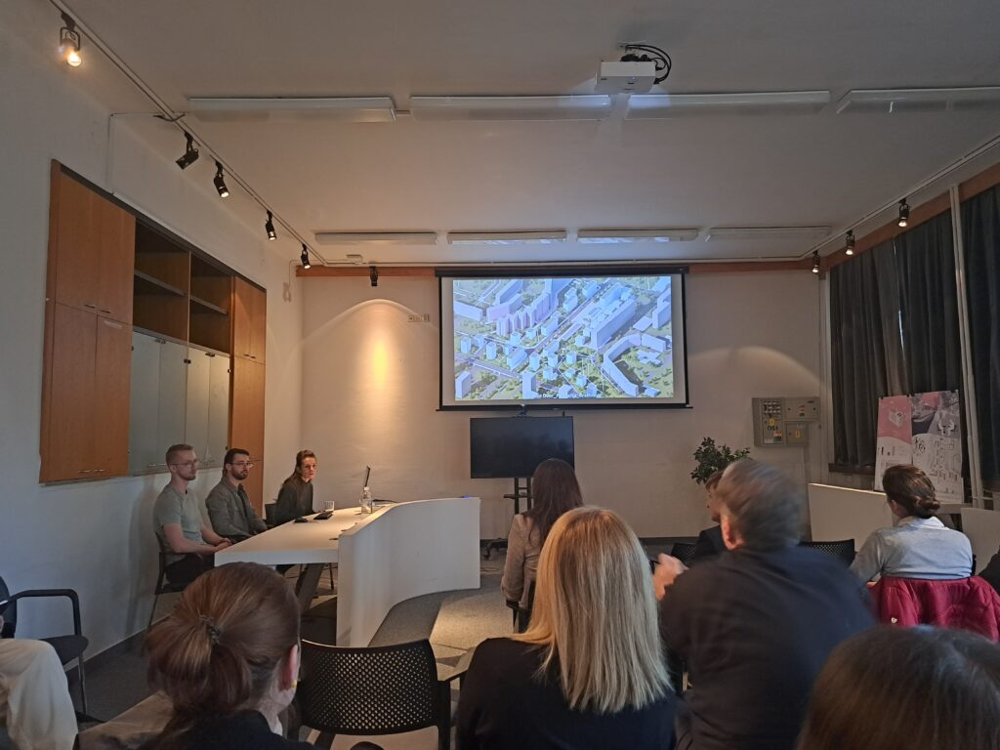
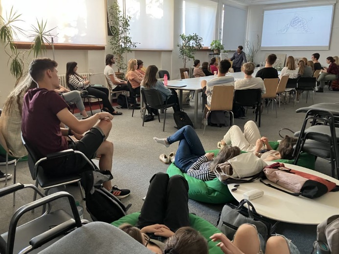
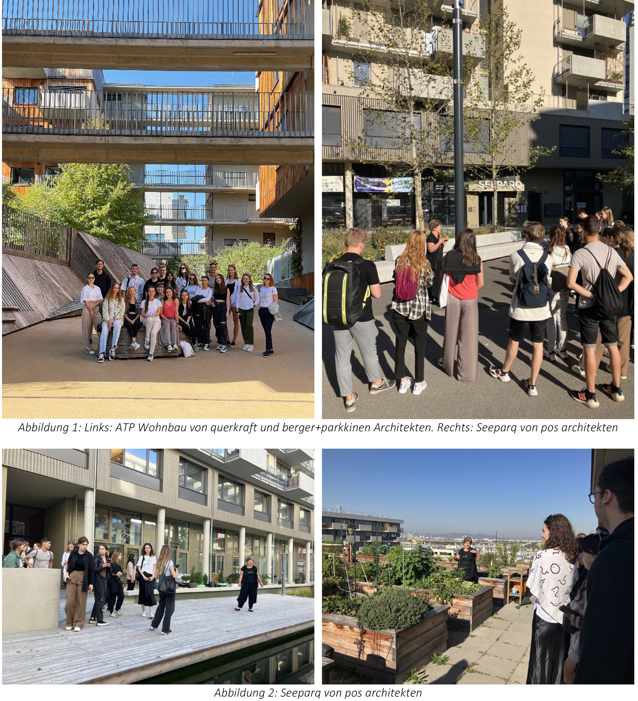

## Ein neues Wahlfach für Plusenergiequartiere

Das Projekt „Plus-Energie-Quartiere: Entwicklungs- und Erneuerungsprinzipien“ erweitert das Hochschullehrangebot in der Slowakei. Das Wahlfach wurde an der **STU Bratislava** entwickelt, erprobt und verankert.

Der Klimawandel verlangt nachhaltige Lösungen für urbane Räume. Gleichzeitig fehlen Fachkräfte für die Entwicklung nachhaltiger Quartiere. Plusenergiequartiere sind bislang unzureichend in akademische Lehrpläne integriert; auch in der Baupraxis und auf kommunaler Ebene ist das Konzept noch wenig verbreitet. Das Projekt setzt deshalb auf praxisnahe Lehrinhalte, die diese Lücke schließen.

## Lehrdurchgänge und Materialien

In den Wintersemestern **2022/23 und 2023/24** fanden zwei Lehrdurchgänge mit insgesamt **49 Absolvent:innen** statt. Das Interesse lag über der ursprünglich erwarteten Teilnahme.

Die Lehrmaterialien umfassen:

- Ein **92-seitiges zweisprachiges Skriptum**.
- Eine Vortragsreihe mit **acht theoretischen Vorträgen**.
- **Zwölf Lehrvideos** und ergänzende Materialien zur Nachlese.
- Ein PED-Bewertungstool, mit dem Architekturstudierende Plusenergiequartiere energetisch modellieren, simulieren und bewerten können.
- **Acht Erklärvideos** zur Anwendung des Berechnungstools.

## Praxisbezug

Entwurfsübungen verbinden die Inhalte mit konkreter Planung. Exkursionen zu realen Quartieren, unter anderem in Wien und der Seestadt Aspern, sowie Beiträge externer Expert:innen schaffen einen direkten Bezug zur Umsetzung.

## Einblicke in das Projekt

::: {.project-gallery}

{fig-alt="Lehrveranstaltung zur Quartiersentwicklung: Eine Präsentation verbindet räumliche Planung mit der gemeinsamen Diskussion."}

{fig-alt="Austausch im Seminarraum: Studierende bearbeiten die Inhalte im direkten Dialog."}

{fig-alt="Exkursionen verbinden die Lehre mit gebauten Quartieren und ermöglichen Diskussionen vor Ort."}

:::

## Projektdaten

| Feld | Angabe |
|:--|:--|
| Konsortium / Koordination | Inštitút pre pasívne domy |
| Laufzeit | Dezember 2022 bis August 2024 |

[← Alle Forschungsprojekte](../projects.qmd)
