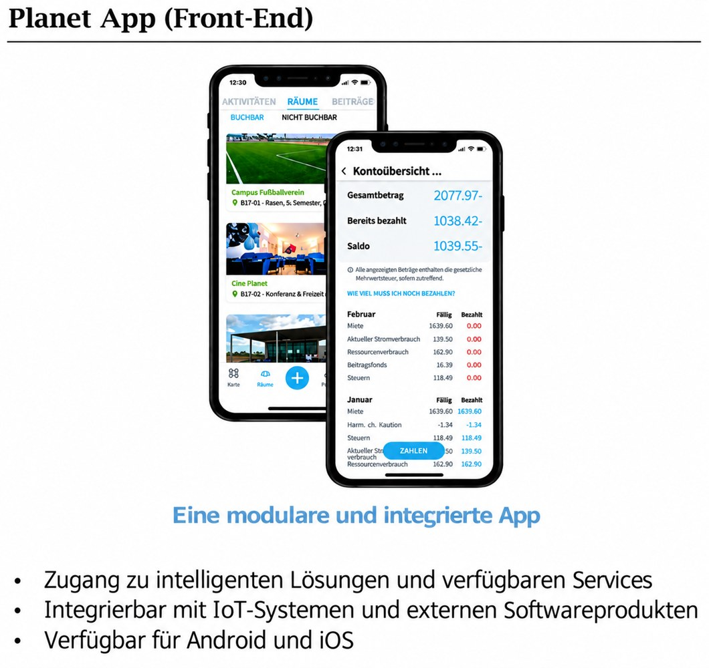

## Worum geht es?

Sechs Demonstrationsstandorte und Energiegemeinschaften dienen als Ausgangspunkt für technologische, soziale und marktbezogene Lösungen. Energiearmut und die Herausforderungen des sozialen Wohnungsbaus stehen im Fokus.

::: {.project-figure}

:::

## Vorgehen und dokumentierter Stand

Das Poster verweist auf eine Wissensplattform mit Berichten und Leitfäden sowie eine App zur Erfassung und Verwaltung von Energiedaten.

## Projektdaten

| Feld | Angabe aus dem Poster |
|:--|:--|
| Laufzeit | 01.10.22- 30.09.26 |
| Projektstatus |  |
| Kontakt | FH-Prof. Momir Tabakovic, momir.tabakovic@technikum-wien.at |
| Beteiligte Organisationseinheiten | Climate-Fit Buildings and Districts |

::: {.callout-note}
Die Angaben geben den Stand der bereitgestellten Unterlagen wieder. Eine vergangene Laufzeit allein belegt keinen Projektabschluss. TODO: Aktuellen Stand, vollständige Partnerliste und freigegebene Publikations- bzw. Ergebnislinks ergänzen.
:::

## Quelle

::: {.source-note}
„Projektdarstellung_RES+AuR_velo.pptx“, Folie 29. Redaktionelle Zusammenfassung für diesen Prototyp; Ziele und erwartete Ergebnisse sind keine nachgewiesenen Wirkungen.
:::

[← Alle Forschungsprojekte](../projects.qmd)
