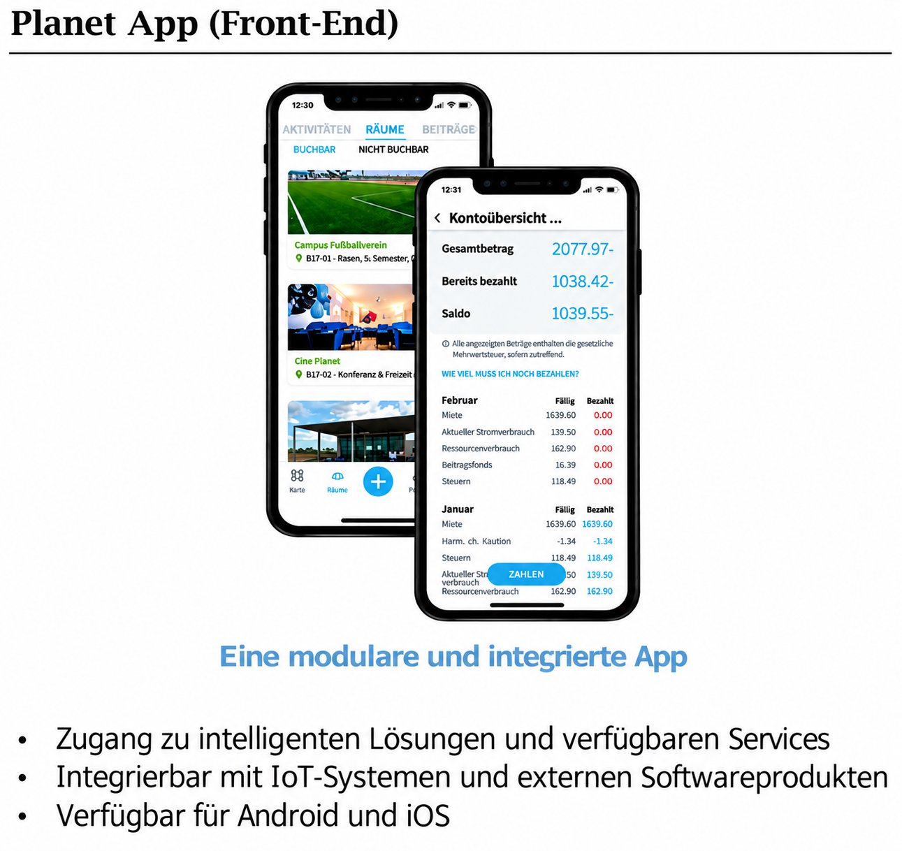
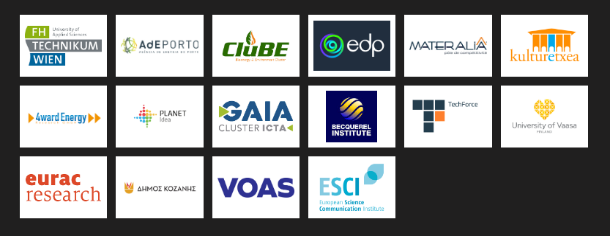

## Ziele

ProLight verbindet energieeffiziente und bezahlbare Wohnlösungen mit einer besseren Lebensqualität. Das Projekt befasst sich mit Energiearmut und den Herausforderungen des sozialen Wohnungsbaus und untersucht, wie Bewohner:innen von Energiegemeinschaften profitieren können.

Weitere Ziele sind ein geringerer Energieverbrauch, die verstärkte Nutzung erneuerbarer Energien und niedrigere CO₂-Emissionen. Partizipative Ansätze sollen den sozialen Zusammenhalt, bürgerschaftliches Engagement und die Zusammenarbeit zwischen Bewohner:innen, lokalen Behörden und weiteren Interessengruppen stärken.

## Sechs Demonstrationsstandorte

Sechs Demonstrationsstandorte und Energiegemeinschaften dienen als städtische Erprobungsräume für technologische, soziale und marktbezogene Lösungen. Ihre Analyse unterstützt die Entwicklung von Modellen zur Übertragung auf andere Quartiere.

## Ergebnisse und Wissenstransfer

Eine Wissensplattform bündelt offen zugängliche Berichte, Erfolgsgeschichten und praktische Leitfäden zu energieeffizienten Gebäuden, Energiegemeinschaften und intelligenten Geräten.

Ein Umsetzungsleitfaden richtet sich an Early Adopters und politische Entscheidungsträger:innen und führt wesentliche Projektergebnisse zusammen.

Die **Planet App** unterstützt die Erfassung und Verwaltung von Energiedaten, die im Rahmen von Workshops vorbereitet werden. Die modulare Anwendung integriert IoT-Systeme und externe Softwareprodukte, bietet Zugang zu intelligenten Lösungen und Services und ist für Android und iOS vorgesehen.

## Einblicke in das Projekt

::: {.project-gallery}

{fig-alt="Die Planet App bündelt Energiedaten und Services in einer modularen Oberfläche und verknüpft IoT-Systeme mit externen Softwareprodukten."}

{fig-alt="Das europäische Projektkonsortium verbindet Hochschulen, Energieakteure, Wohnungswirtschaft und weitere Umsetzungspartner."}

:::

## Projektdaten

| Feld | Angabe |
|:--|:--|
| Konsortium / Koordination | FH Technikum Wien (Koordination) und 16 EU-Partner |
| Laufzeit | 01.10.2022 – 30.09.2026 |

[← Alle Forschungsprojekte](../projects.qmd)
