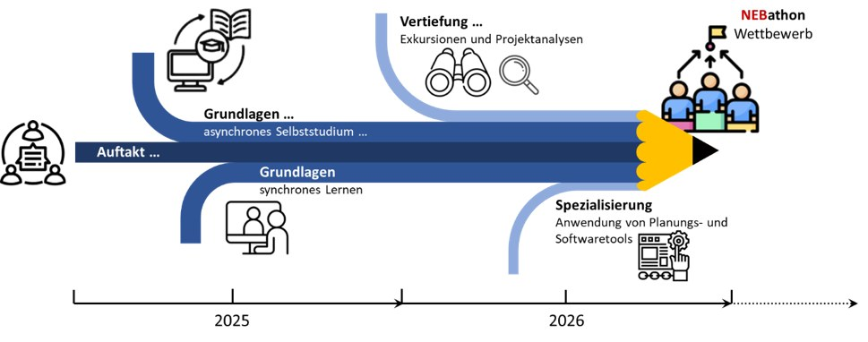

## Worum geht es?

Das Qualifizierungsnetzwerk verbindet Nachhaltigkeit, Integration und Ästhetik. Workshops zu Bewertungstools, Quartiersexkursionen und ein NEBathon fördern die Zusammenarbeit über Disziplinen und Sektoren hinweg.

::: {.project-figure}

:::

## Forschung und Anwendung

Grundlagen- und Spezialisierungsschulungen vermitteln die gemeinsame Methodenbasis. Weitere Lehrmaterialien und ein frei zugänglicher Online-Kurs sind für den Wissenstransfer vorgesehen.

## Projektdaten

| Feld | Angabe |
|:--|:--|
| Laufzeit | 24 Monate: 4/2025 – 3/2027 |

[← Alle Forschungsprojekte](../projects.qmd)
