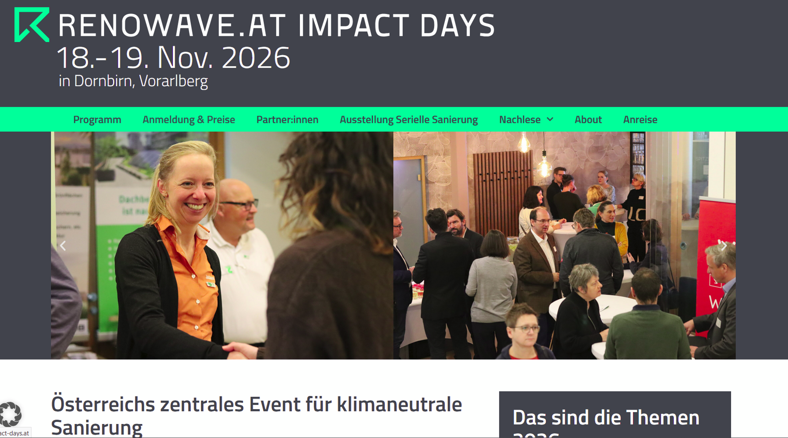

## Innovationslabor für die Sanierung

RENOWAVE.AT ist eine unabhängige Anlaufstelle für Innovationen in der klimaneutralen Gebäude- und Quartierssanierung. Das Labor unterstützt unter anderem Initiator:innen von Demonstrationsgebäuden und -quartieren und setzt Impulse für einen klimaneutralen Gebäudebestand.

## Innovationsfelder

- Multifunktionale, klimaneutrale Gebäudehüllen.
- Erneuerbare und klimaneutrale Energieversorgung.
- Nutzer:innenintegration und Prozessbegleitung.
- Geschäftsmodelle und rechtliche Rahmenbedingungen.
- Interdisziplinäre, ganzheitliche Planungs-, Bau- und Betriebsprozesse.
- Baukultur und New European Bauhaus.

## Zusammenarbeit

Das Innovationslabor wird von einer Genossenschaft mit mehr als 30 Partner:innen getragen. Die FH Technikum Wien hat es gemeinsam mit Unternehmen und weiteren Forschungseinrichtungen mitinitiiert und ist als Genossenschafterin beteiligt.

RENOWAVE.AT schafft eine gemeinsame Infrastruktur für Innovationsvorhaben und deren praktische Umsetzung.

## Einblicke in das Projekt

::: {.project-gallery}

{fig-alt="RENOWAVE.AT als Plattform für Austausch und Innovation: Die Darstellung verbindet Fachveranstaltungen mit Themen der klimaneutralen Sanierung."}

:::

## Projektdaten

| Feld | Angabe |
|:--|:--|
| Konsortium / Koordination | Genossenschaft mit mehr als 30 PartnerInnen |
| Laufzeit | 11/2021 – 11/2026 |

[← Alle Forschungsprojekte](../projects.qmd)
