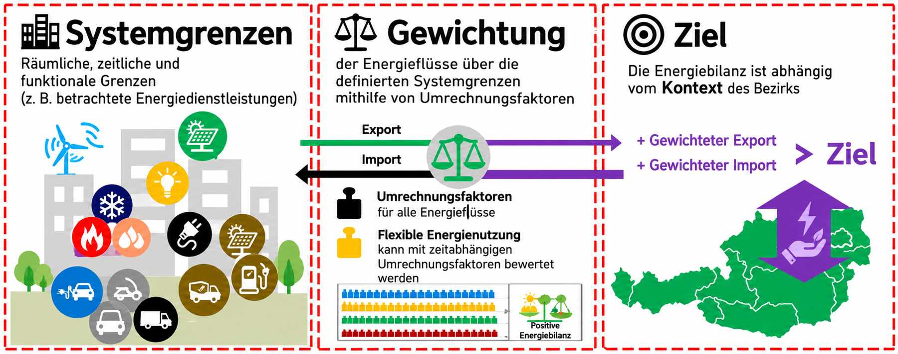

## Städte und Gemeinden auf dem Weg zum Plusenergiequartier

SIMPLY POSITIVE entwickelt Strategien, Konzepte und Leitlinien, um die Beteiligung von Gemeinden und Städten an Positive Energy Districts (PEDs) und Positive Energy Neighborhoods (PENs) zu stärken.

## Methodischer Rahmen

Das gemeinsame PED-Rahmenkonzept verbindet vier Aufgaben:

1. Bestehende kommunale Klima- und Umweltstrategien weiterentwickeln und die Nutzung sauberer Energie ausbauen.
2. Ein standardisiertes, praxistaugliches Verfahren zur Energiebilanzierung auf Grundlage verfügbarer Daten entwickeln.
3. Ein Monitoring zur Erfassung, Bewertung und Überprüfung von Maßnahmen einrichten.
4. Beteiligungsstrategien hinsichtlich Wirkung und Akzeptanz bewerten.

## Erprobung in vier Ländern

In Schwerpunktbezirken in **Österreich, Rumänien, Italien und den Niederlanden** wurden Strategien für die Energiewende entwickelt und erprobt. Die ausgewählten Handlungsfelder umfassten:

- Den Ausbau von Photovoltaikanlagen.
- Die Integration von Elektrofahrzeugen in Mobilitätskonzepte und ihre Nutzung als Energiespeicher.
- Nutzungsmuster zur Steigerung der Energieeffizienz.
- Gemeinsame Klima- und Energieaktionspläne.

## Ergebnisse und Übertragbarkeit

Ein gemeinsamer Definitionsrahmen für Plusenergiequartiere im Bestand unterstützt die Überwachung und Visualisierung der Ergebnisse. Die Methodik verbindet Systemgrenzen, Gewichtung und kontextabhängige Zielwerte.

Beteiligungskonzepte fördern die aktive Mitwirkung der Interessengruppen und unterstützen die Übertragung auf weitere europäische Städte und Gemeinden.

## Einblicke in das Projekt

::: {.project-gallery}

{fig-alt="PED-Methodik in drei Schritten: Systemgrenzen festlegen, Energieflüsse gewichten und ein zum regionalen Kontext passendes Ziel bestimmen."}

:::

## Projektdaten

| Feld | Angabe |
|:--|:--|
| Koordinator | Sonnenplatz Großschönau GmbH |
| Laufzeit | 01/ 2023 – 12/2024 |

[← Alle Forschungsprojekte](../projects.qmd)
