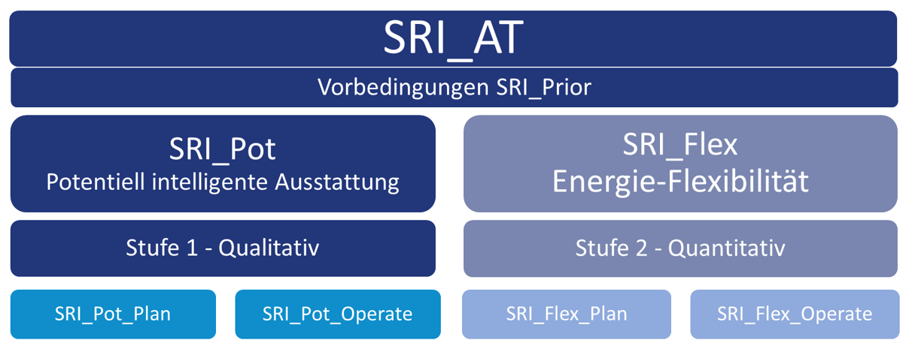

## Zielsetzung

Der Smart Readiness Indicator (SRI) soll Gebäude auf die Anforderungen erneuerbarer Energienetze vorbereiten. SRI Demo testet intelligente Maßnahmen in unterschiedlichen Demonstrationsgebäuden, entwickelt eine praxistaugliche Methodik für Österreich und gestaltet die nationale sowie die europäische Testphase mit.

## Arbeitsschritte

- Intelligente Maßnahmen in Demonstrationsgebäuden umsetzen und erproben.
- Berechnungsergebnisse und Praxiserfahrungen auswerten.
- Nationale und europäische SRI-Methoden vergleichen und weiterentwickeln.
- Eine Online-Plattform zur Gebäudeselbstbewertung entwickeln.
- Wirkungsbasierte Indikatoren für Planung und Betrieb entwickeln.
- Eine Messinfrastruktur im F-Gebäude der FH Technikum Wien aufbauen.
- Die offizielle SRI-Berechnungsmethode evaluieren.

## Methodische Ergebnisse

Die vorgeschlagene Methodik unterscheidet zwischen technischer Ausstattung und tatsächlicher Flexibilitätswirkung:

| Indikatoren | Bewertungsgegenstand |
|:--|:--|
| SRI_Pot_Plan und SRI_Pot_Operate | Geplante und operative technische Ausstattung. |
| SRI_Flex_Plan und SRI_Flex_Operate | Zu erwartende und gemessene Flexibilitätswirkung. |

Ein Methodikbericht unterstützt die nationale Entscheidungsgrundlage zur SRI-Definition. Stakeholderworkshops, der Austausch auf der iSRIc-Konferenz und eine Fachartikelserie in **OIB Aktuell** tragen die Ergebnisse in die Fachöffentlichkeit.

## Validierung und Lehre

Die bis Januar 2027 verlängerte Projektlaufzeit dient insbesondere der Validierung der entwickelten Indikatoren. Messungen im Sommer- und Winterbetrieb, Tests von Maßnahmen und Vergleiche mit der EU-Methodik bilden dafür die Grundlage.

Die Auswertung der Daten und die Publikation der Ergebnisse werden mit Lehrveranstaltungen und Projektarbeiten verbunden.

## Einblicke in das Projekt

::: {.project-gallery}

{fig-alt="Die SRI-Systematik trennt qualitative Potenziale intelligenter Ausstattung von quantitativer Energieflexibilität. Beide Ebenen werden für Planung und Betrieb betrachtet."}

:::

## Projektdaten

| Feld | Angabe |
|:--|:--|
| Koordinator | AEE INTEC |
| Partner | TU Wien, AIT, IBO, FH Technikum Wien, BOKU |
| Laufzeit | 05/2023 bis 01/2027 |

[← Alle Forschungsprojekte](../projects.qmd)
