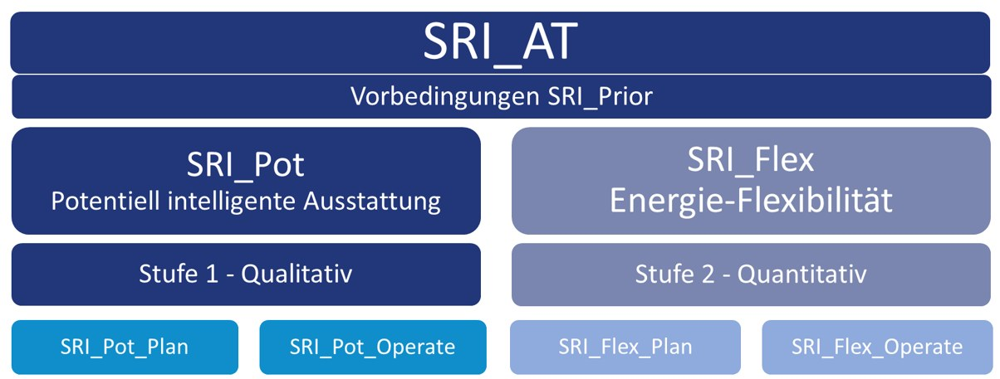

## Worum geht es?

Demonstrationsgebäude dienen zur Erprobung smarter Maßnahmen und zur Weiterentwicklung des Smart Readiness Indicator. Geplante Ausstattung und gemessene Wirkung werden getrennt betrachtet.

::: {.project-figure}

:::

## Forschung und Anwendung

Methodikvorschläge und Stakeholderworkshops unterstützen die Weiterentwicklung der österreichischen SRI-Methodik. Messungen und Validierung der Indikatoren verbinden die Bewertung mit der Anwendung in Gebäuden.

## Projektdaten

| Feld | Angabe |
|:--|:--|
| Laufzeit | 05/2023 bis 01/2027 |

[← Alle Forschungsprojekte](../projects.qmd)
