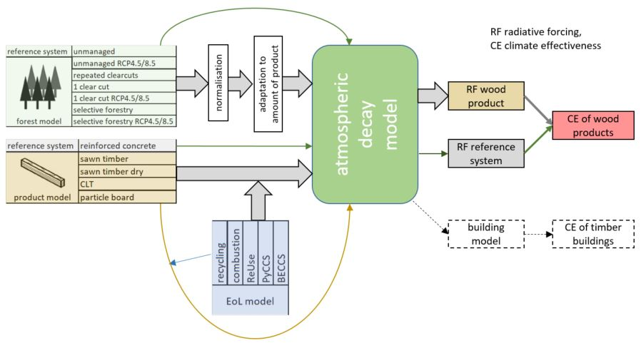
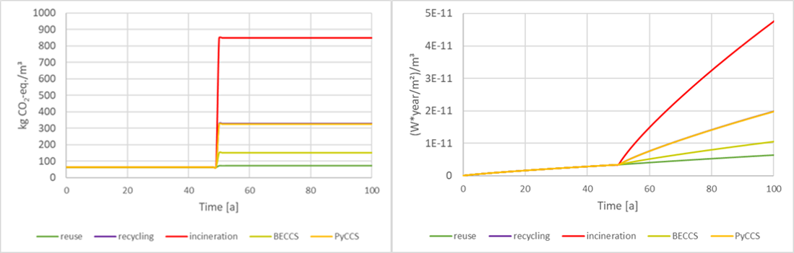
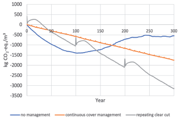

## Zielsetzung

TimberBioC untersucht die zeitliche Speicherung von CO₂ in langlebigen Holzbauprodukten. Dynamische Modelle sollen eine belastbare Grundlage für ökologische Bewertungen schaffen und die Klimawirkung der Holznutzung über die Zeit abbilden.

Das Projekt verbindet ein ganzheitliches Modell mit Fragen der Kreislaufwirtschaft, der Anwendung in normativen Regelwerken und der Umweltkommunikation gegenüber Konsument:innen.

## Vier Arbeitsschwerpunkte

### Holz als Kohlenstoffsenke

Untersucht wird, wie biogener Kohlenstoff in Hintergrunddatenbanken, Umweltproduktdeklarationen und Wäldern berücksichtigt wird. Das Modell verknüpft Forstwirtschaft und Produktleben und betrachtet den Einfluss der Bewirtschaftung auf die CO₂-Speicherung sowie Einsatz und Verfügbarkeit von Holz für langlebige Bauprodukte.

### Kreislaufwirtschaft im Holzbau

Bestehende Regelwerke zum Lebensende von Produkten werden auf Defizite untersucht. Möglichkeiten zur Nachnutzung sollen die Dauer des Kohlenstoffentzugs aus der Atmosphäre verlängern und werden mit dem dynamischen Modell verknüpft.

### Vereinfachtes Modell für Nachhaltigkeitsbewertungen

Aus Anforderungen und dynamischen Modellergebnissen wird ein vereinfachter Ansatz abgeleitet. Unsicherheiten und Anwendungsbedingungen sind Teil der Bewertung.

### Anwendung in Bewertungssystemen

Bestehende B2C-Bewertungssysteme für Produkte werden analysiert und anhand von Vergleichsrechnungen mit der neuen Methode untersucht.

## Ergebnisse und Transfer

Die Ergebnisse des abgeschlossenen Projekts wurden publiziert und in Lehrveranstaltungen und Projektarbeiten integriert. Die entwickelte Systematik wird in „aspern klimafit 2.0“ und im Standard „klimaaktiv klimaneutrale Plusenergie“ aufgegriffen.

Die Abbildungen zeigen die Modellsystematik, kumulative CO₂-Flüsse und den Strahlungsantrieb unter verschiedenen Lebensend- und Bewirtschaftungsszenarien.

## Einblicke in das Projekt

::: {.project-gallery}

{fig-alt="Modellsystematik von TimberBioC: Forstwirtschaft, Produktleben und Klimawirkung werden in einem dynamischen Modell miteinander verknüpft."}

{fig-alt="Kumulativer CO₂-Fluss links und Strahlungsantrieb rechts für einen Kubikmeter Schnittholz unter verschiedenen Szenarien am Lebensende."}

{fig-alt="Vergleich kumulativer CO₂-Flüsse unterschiedlicher Waldbewirtschaftung über die Zeit: Ohne Bewirtschaftung, mit kontinuierlicher Waldbedeckung und bei wiederholtem Kahlschlag ergeben sich unterschiedliche Verläufe."}

:::

## Projektdaten

| Feld | Angabe |
|:--|:--|
| Konsortium / Koordination | IBO (lead), BOKU (Waldbau), FH Technikum Wien |
| Laufzeit | 07/2022 – 06/2024 |

[← Alle Forschungsprojekte](../projects.qmd)
