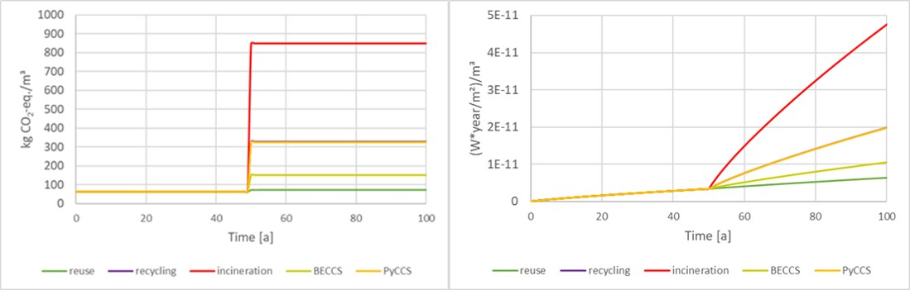

## Worum geht es?

Dynamische Modelle verbinden Forstwirtschaft, Produktlebensdauer und Nachnutzung langlebiger Holzbauprodukte. Die zeitliche Speicherung von Kohlenstoff wird für ökologische Bewertungen untersucht.

::: {.project-figure}

:::

## Vorgehen und dokumentierter Stand

Das Poster bezeichnet das Projekt als abgeschlossen und berichtet über eine entwickelte Systematik sowie die Integration in Lehre und Bewertungsstandards.

## Projektdaten

| Feld | Angabe aus dem Poster |
|:--|:--|
| Laufzeit | 07/2022 – 06/2024 |
| Projektstatus |  |
| Kontakt | DI Thomas Zelger |
| Beteiligte Organisationseinheiten | CBD |

::: {.callout-note}
Die Angaben geben den Stand der bereitgestellten Unterlagen wieder. Eine vergangene Laufzeit allein belegt keinen Projektabschluss. TODO: Aktuellen Stand, vollständige Partnerliste und freigegebene Publikations- bzw. Ergebnislinks ergänzen.
:::

## Quelle

::: {.source-note}
„Projektdarstellung_RES+AuR_velo.pptx“, Folie 37. Redaktionelle Zusammenfassung für diesen Prototyp; Ziele und erwartete Ergebnisse sind keine nachgewiesenen Wirkungen.
:::

[← Alle Forschungsprojekte](../projects.qmd)
