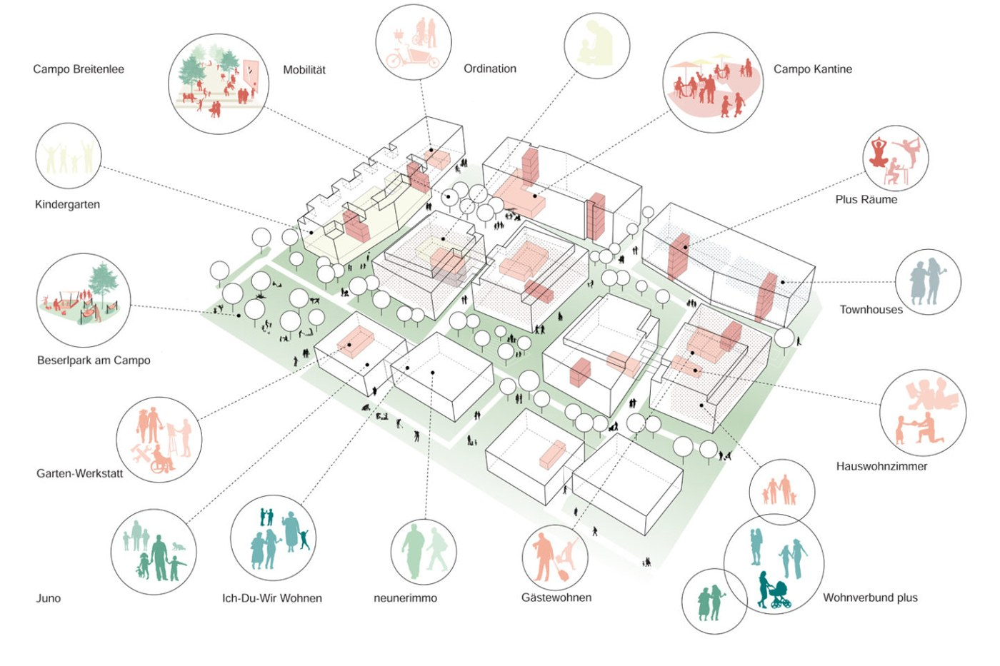

## Worum geht es?

Demonstrationsquartiere verbinden technische Systemlösungen mit Monitoring, Nutzer:innenbedürfnissen und rechtlichökonomischen Rahmenbedingungen. Ziel ist die Übertragbarkeit von Plusenergiequartieren.

::: {.project-figure}

:::

## Forschung und Anwendung

Datenauswertung, Berichterstattung und der Transfer in Lehre und Publikationen bündeln die Erkenntnisse aus den Demonstrationsquartieren.

## Projektdaten

| Feld | Angabe |
|:--|:--|
| Laufzeit | 09/2021 – 06/2026 |

[← Alle Forschungsprojekte](../projects.qmd)
