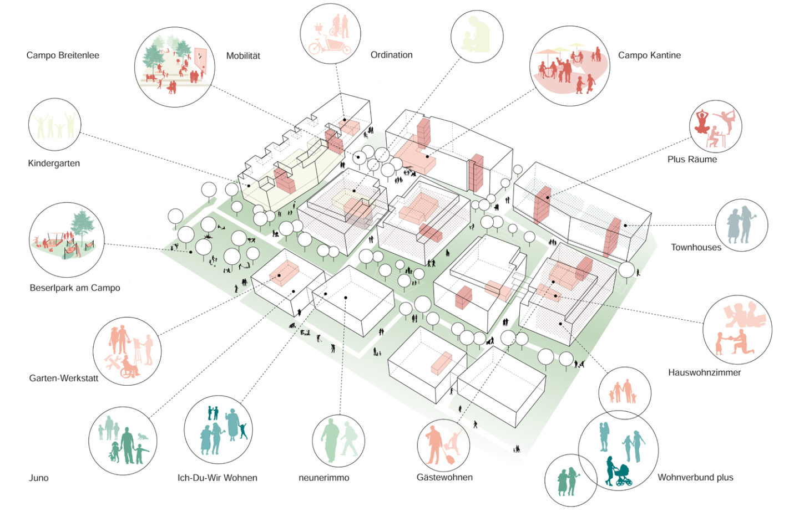
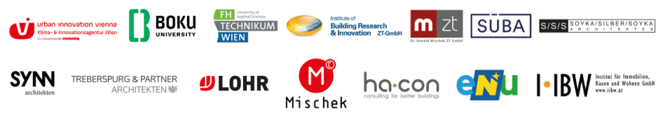

## Urbane Zukunftsquartiere umsetzen

ZQ3Demo verbindet die Umsetzung urbaner Plusenergiequartiere mit Akteursvernetzung und rechtlich sowie wirtschaftlich übertragbaren Lösungen. Reale Demonstrationsquartiere werden durch Monitoring und begleitende Forschung untersucht.

Das Projekt berücksichtigt die Perspektiven von Planenden, Nutzenden und Umsetzenden: nachhaltige System-, Architektur- und Technologiekonzepte, hohe Lebensqualität bei niedrigen Kosten sowie geeignete rechtliche Rahmenbedingungen und Geschäftsmodelle.

## Vier Ziele

### Plusenergiequartiere sichtbar machen

Demonstrationsquartiere dienen als Vorzeigemodelle. Begleitforschung und Monitoring erschließen Erkenntnisse für zukünftige Projekte.

### Intelligente und effiziente Energielösungen entwickeln

Systemlösungen sollen Energieverbrauch und CO₂-Emissionen reduzieren. Intelligente Steuerung, Eigenstromnutzung und kontinuierliche Betriebsoptimierung werden hinsichtlich ihres Beitrags zum Energiesystem und zu Klimazielen bewertet.

### Akzeptanz und Komfort stärken

Verständliche Informations- und Kommunikationsangebote unterstützen die Einbindung der Nutzer:innen. Komfort, Nutzungsverhalten und die Bereitschaft zur Beteiligung werden untersucht.

### Verbreitung und Umsetzung erleichtern

Erfolgsfaktoren und Hindernisse werden identifiziert, praxistaugliche Geschäftsmodelle entwickelt und der Austausch zwischen den Beteiligten gefördert.

## Arbeitsschritte

1. Technische Systemlösungen für energieflexible Plusenergiequartiere entwickeln.
2. Lösungen realisieren, überwachen und optimieren.
3. Bedürfnisse, Erwartungen und Akzeptanz der Nutzer:innen erheben.
4. Rechtliche und wirtschaftliche Rahmenbedingungen und Spielräume untersuchen.
5. Erkenntnisse ableiten und zusammenführen.

## Auswertung und Weiterführung

Die Abschlussarbeiten umfassen die Auswertung gesammelter Daten, das Aufzeigen von Verbesserungspotenzialen, Berichterstattung und Publikationen. Ergebnisse fließen in Lehrveranstaltungen und Abschlussarbeiten ein und bilden eine Grundlage für mögliche Folgeprojekte.

Die Erfahrungen und Rückmeldungen der beteiligten Bewohner:innen tragen dazu bei, praxisnahe Lösungen zu entwickeln. **Campo Breitenlee** ist eines der dargestellten Demonstrationsquartiere.

## Einblicke in das Projekt

::: {.project-gallery}

{fig-alt="Nutzungsvielfalt im Demonstrationsquartier Campo Breitenlee: Die räumliche Darstellung verbindet Gebäude, Freiräume und gemeinschaftliche Nutzungen."}

{fig-alt="Partner des Demonstrationsvorhabens aus Forschung, Planung, Bau, Energie und Immobilienwirtschaft."}

:::

## Projektdaten

| Feld | Angabe |
|:--|:--|
| Konsortialpartner | Urban Innovation Vienna |
| Laufzeit | 09/2021 – 06/2026 |

[← Alle Forschungsprojekte](../projects.qmd)
